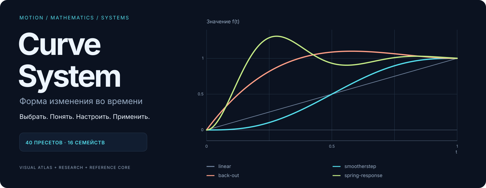
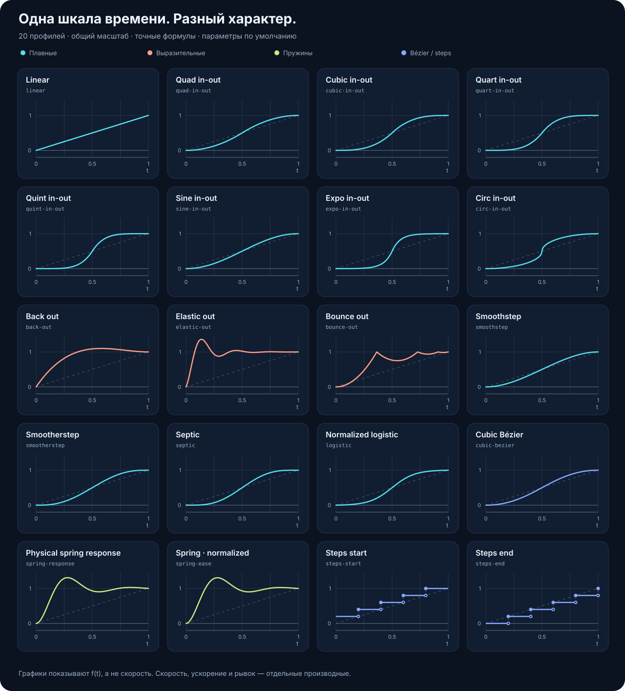
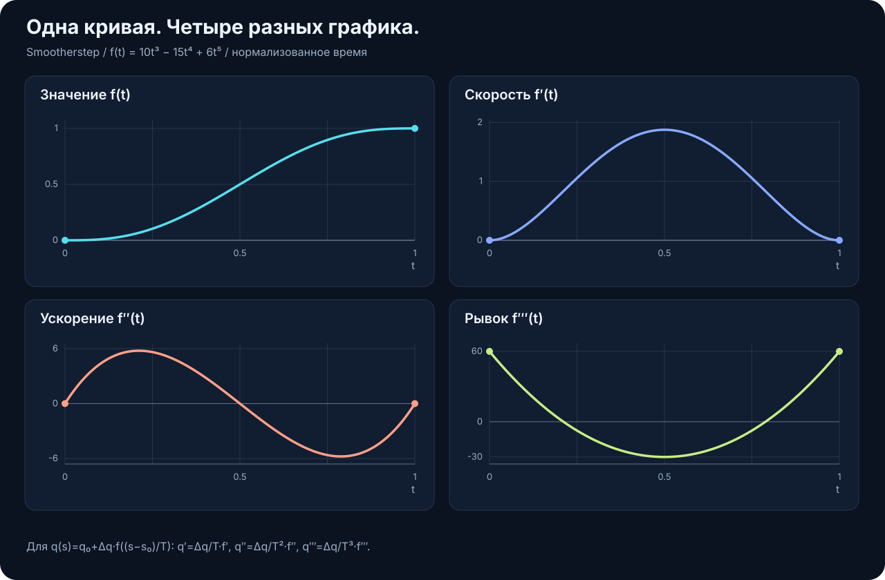

<div align="center">



# Curve System

**Визуальный атлас, математическая библиотека и исследовательская база для управления изменениями во времени.**

Анимация · моушен-дизайн · видеомонтаж · интерфейсы · графика · огибающие · движение камер

[Открыть атлас](docs/catalog.md) · [Два исследования](research/README.md) · [Библиотеки и демо](research/resources.md) · [Запустить Curve Lab](#curve-lab--посмотреть-кривую-в-движении) · [Инструкции для агента](skills/curve-system/SKILL.md)

</div>

## Что это за проект

Один и тот же переход можно сделать резким, спокойным, инерционным, упругим или ступенчатым. Разница определяется тем, **как значение изменяется во времени**: когда движение начинается, где набирает скорость, как тормозит и что происходит после достижения цели.

Curve System собирает эти способы изменения в общую, проверяемую систему. Здесь можно увидеть кривую, разобраться в её математике, сравнить движение, настроить параметры и передать выбранный вариант в свой проект или ИИ-агенту.

Проект задуман как самостоятельная основа для разных сред. Нейромонтаж, After Effects, Blender, браузер, игровой движок или аудиоредактор — возможные потребители одного описания кривой. **Готовность адаптеров указана отдельно:** текущая версия содержит собственное вычислительное ядро и браузерную лабораторию, а интеграции с редакторами пока описаны в документации.

### Уже есть в версии 0.1

| Часть | Содержимое | Где посмотреть |
|---|---|---|
| Визуальный атлас | 40 пресетов, 16 семейств; отдельная SVG-карточка каждого пресета | [Каталог](docs/catalog.md) |
| Curve Lab | Настройка параметров, сравнение двух кривых, четыре графика, движущийся маркер, JSON/CSV и точный CSS для поддерживаемых случаев | [Исходники и запуск](examples/playground.html) |
| Эталонное ядро | JavaScript ESM, вычисление значения и трёх производных, без runtime-зависимостей | [src/curves.mjs](src/curves.mjs) |
| Исследование 01 | Математика и междисциплинарный атлас: от easing до планирования движения | [Curve Atlas](research/01-curve-atlas.md) |
| Исследование 02 | Готовые разработки, архитектурные решения, переносимость и агентский workflow | [Engine & Agent](research/02-engine-and-agent.md) |
| Машиночитаемые данные | Реестр, параметры, ограничения, первоисточники и JSON Schema | [Реестр](catalog/curves.json) |
| Скилл для агента | Выбор по задаче, проверка границ, визуализация и перенос | [SKILL.md](skills/curve-system/SKILL.md) |

Это **исследовательский прототип и рабочая отправная точка**, а не готовый промышленный движок для всех сред. Новые семейства и интеграции развиваются по [дорожной карте](docs/roadmap.md).

## Основные семейства — одним взглядом



Каждая линия здесь вычислена программно из того же кода, который работает в лаборатории. Выход за границы 0–1 сохранён: у back, elastic и некоторых пружин он составляет часть поведения. Цвет и название помогают найти семейство; точные свойства, варианты `in`, `out`, `in-out` и параметры находятся в [полном атласе из 40 карточек](docs/catalog.md).

| Нужное поведение | С чего начать | Что проверить |
|---|---|---|
| Равномерное изменение | `linear` | Мгновенную смену скорости при старте и остановке |
| Разгон или торможение | `quad-*`, `cubic-*`, `sine-*` | Скорость на обоих концах и стыки сегментов |
| Мягкий старт и мягкая остановка | `smoothstep`, `smootherstep` | Достаточна ли непрерывность ускорения |
| Нулевой рывок в начале и конце | `septic` | Ограничения скорости и ускорения всё ещё задаются отдельно |
| Свободно настроить характер | `cubic-bezier` | Граничные наклоны, overshoot и инверсию времени |
| Предварительное движение назад | `back-in` | Допустимо ли отрицательное значение параметра |
| Пружинный характер | `elastic-out`, `spring-ease` | Они используют разные модели; конец окна может быть резким |
| Физический ответ системы | `spring-response` | Значение в конце окна не обязано быть ровно 1 |
| Столкновения и отскоки | `bounce-out` | Разрывы скорости в точках удара |
| Дискретные состояния | `steps-start`, `steps-end` | В какой момент происходит скачок |

Названия из разных библиотек не всегда означают одну и ту же формулу. В частности, `expo-*` и `elastic-*` в этой версии непрерывно нормированы по значениям на концах; они не являются точными копиями функций Penner с отдельной подстановкой крайних значений. Формула и версия важнее одного имени.

## Не только форма линии: значение, скорость, ускорение и рывок



Для нормализованного времени $t\in[0,1]$ кривая задаёт прогресс $f(t)$. Если переход длится $T$ секунд и меняет значение от $q_0$ до $q_1$, то:

$$q(\tau)=q_0+(q_1-q_0)f(\tau/T).$$

Физическая скорость равна $(q_1-q_0)f'(t)/T$, ускорение — $(q_1-q_0)f''(t)/T^2$, рывок — $(q_1-q_0)f'''(t)/T^3$. Уменьшить длительность вдвое означает увеличить соответствующие величины в 2, 4 и 8 раз.

**S-образный график значения и колоколообразный график скорости могут описывать одно движение.** В After Effects Value Graph и Speed Graph показывают разные характеристики; траектория Position добавляет ещё и пространственную составляющую. Это различие отражено в [документации Adobe](https://helpx.adobe.com/after-effects/desktop/animate-in-after-effects/animation-basics/animation-basics.html) и подробно разобрано в [математическом справочнике](docs/mathematics.md).

## Curve Lab — посмотреть кривую в движении

```sh
git clone https://github.com/i4w7w4a/Curve-System.git
cd Curve-System
python3 -m http.server 8000
```

Открыть **http://localhost:8000/examples/playground.html**.

Установка npm-пакетов для запуска не требуется. Нужен современный браузер с поддержкой ES modules. Открывать файл через `file://` не следует: браузер может заблокировать загрузку модулей.

В лаборатории можно:

- выбрать пресет и найти его по имени или семейству;
- менять контрольные точки Bézier, затухание, частоту, число колебаний и другие доступные параметры;
- сравнивать выбранную кривую с другой при одинаковом времени;
- отдельно смотреть значение, скорость, ускорение и рывок;
- проигрывать движение или вручную двигать временной курсор;
- копировать описание в JSON, выгружать 241 отсчёт в CSV и получать точный CSS там, где он реализован.

Графики используют реальные значения, а разрывы не соединяются ложной гладкой линией. Автовоспроизведения нет. Для пружин физический горизонт `duration` внутри модели и длительность просмотра — разные параметры: их смысл объяснён в [руководстве](docs/usage.md).

GitHub отображает SVG прямо в README. Интерактивный HTML запускается локально; публикация GitHub Pages в этой версии не настраивалась.

## Использовать в коде

```js
import { evaluate, derivatives, sample, toCSS } from './src/curves.mjs';

const progress = evaluate('smootherstep', 0.3); // 0.16308
const position = 100 + (500 - 100) * progress;

const state = derivatives('smootherstep', 0.5);
// { value: 0.5, velocity: 1.875, acceleration: 0, jerk: -30 }

const frames = sample('back-out', 121, { overshoot: 1.5 });
const css = toCSS('cubic-bezier', { x1: 0.22, y1: 0, x2: 0.36, y2: 1 });
```

Контракт строгий: время должно быть конечным числом на `[0,1]`, параметры — допустимыми для выбранного семейства. Неопределённая производная возвращается как `null`; output не обрезается. Примеры физического времени, CSS и After Effects — в [руководстве по применению](docs/usage.md).

## Исследования и готовые разработки

Два отдельных обзора связывают математику и практическую сборку проекта:

1. **[Curve Atlas: математика изменения во времени](research/01-curve-atlas.md)** — easing, интерполяция, пружины, сплайны, minimum jerk/snap, time warping, аудиоогибающие и ограничения междисциплинарного переноса.
2. **[Curve Engine & Agent: от библиотек к единой системе](research/02-engine-and-agent.md)** — проверенные проекты, визуальные редакторы, форматы, лицензии, архитектурные решения и правила работы агента.

Отдельно: **[каталог GitHub, живых демо, документации, Habr и X](research/resources.md)**. В нём указано, для чего полезен каждый источник, какая лицензия проверена и какие вопросы остались открытыми. Методика и состояние исследований — в [research/README.md](research/README.md). Дата этой редакции: **24 ноября 2026**.

## Как устроен репозиторий

| Путь | Назначение |
|---|---|
| [`src/`](src/curves.mjs) | Единый evaluator и метаданные кривых |
| [`catalog/`](catalog/curves.json) | Генерируемый реестр и схемы обмена |
| [`assets/`](assets/gallery.svg) | SVG-галерея, производные и карточки всех пресетов |
| [`examples/`](examples/playground.html) | Работающая браузерная лаборатория |
| [`docs/catalog.md`](docs/catalog.md) | Формулы, параметры и визуальные карточки |
| [`docs/mathematics.md`](docs/mathematics.md) | Математическая семантика и граничные условия |
| [`docs/architecture.md`](docs/architecture.md) | Текущая архитектура и контракт будущих адаптеров |
| [`research/`](research/README.md) | Два эссе и реестр внешних источников |
| [`skills/curve-system/`](skills/curve-system/SKILL.md) | Переносимые инструкции для агента |
| [`tests/`](tests/curves.test.mjs) | Проверки математических свойств и численной устойчивости |
| [`scripts/`](scripts/render-atlas.mjs) | Воспроизводимая сборка атласа и проверка ссылок |

## Воспроизвести и развивать

Для проверки и пересборки нужен Node.js 20 или новее:

```sh
npm test
npm run build:atlas
npm run check:docs
```

[Как внести вклад](CONTRIBUTING.md) · [Дорожная карта](docs/roadmap.md) · [Проверки и ограничения](docs/validation.md) · [История изменений](CHANGELOG.md) · [Происхождение и лицензии](THIRD_PARTY.md)

Приоритеты следующего этапа — редактируемые piecewise-кривые, Hermite/PCHIP, адаптивный экспорт с измеряемой ошибкой, stateful-пружины и проверенные адаптеры к видеоредакторам. Полная модель таймлайна, оптимизатор траекторий и аудио-DSP пока не реализованы.

### Лицензирование

Общая лицензия Curve System пока не выбрана владельцем (`UNLICENSED` в `package.json`). Лицензии исследуемых сторонних проектов действуют независимо. Их код и изображения в эту версию не включены; SVG и reference implementation созданы для этого проекта. Перед переиспользованием сторонней реализации нужно проверить конкретную лицензию и версию — одного публичного GitHub-адреса недостаточно.
