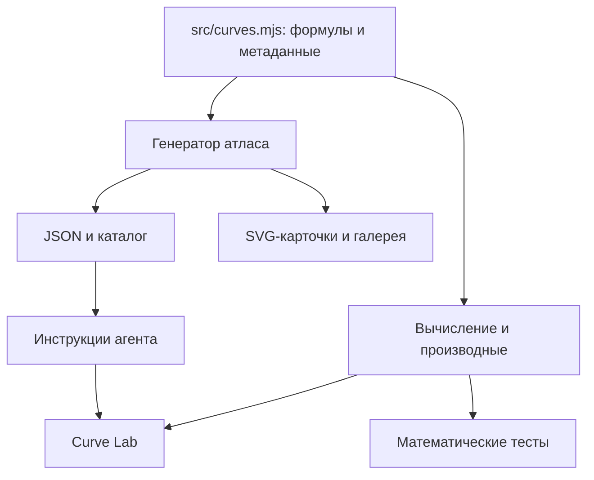

# Архитектура Curve System

**Статус:** описание работающего прототипа 0.1 и отдельно обозначенные направления развития. Последнее обновление: 24 ноября 2026.

## 1. Единица системы — функция с контрактом

Кривая — это не название и не картинка. Для воспроизводимого переноса нужны как минимум идентификатор, точная формула/модель, параметры, область определения, семантика времени, выходной диапазон и поведение на границах. Пресеты с одинаковым словом `spring` могут задавать затухающий косинус, аналитический ответ дифференциального уравнения или численный stateful-процесс. Их нельзя считать взаимозаменяемыми по имени.

В этой версии ядро вычисляет скалярный прогресс `f(t)` на нормализованном интервале `[0,1]`. Привязка к пикселям, процентам, углу, кадру, громкости или пространственной траектории остаётся на стороне приложения. Для многомерной траектории `r(u)` итог `r(f(t))` требует отдельного анализа геометрии и длины дуги; одного скалярного easing недостаточно для гарантии постоянной пространственной скорости. См. [математику](mathematics.md).

## 2. Реализованная структура



Это схема текущих зависимостей, а не набор отдельно развёрнутых сервисов. База данных, серверный API и сторонний анимационный движок не требуются.

| Слой | Реализовано сейчас | Граница |
|---|---|---|
| Математическое ядро | Pure functions, 40 пресетов, 3 производные, события разрыва, строгая валидация | Один сегмент, фиксированный набор семейств |
| Метаданные | Формулы, параметры, источники, свойства и заметки | Часть свойств зависит от параметров и отмечена строкой `parameter-dependent` |
| Представление | SVG, Markdown, интерактивные SVG-графики и движущийся маркер | Полного timeline-редактора нет |
| Обмен | Реестр JSON, описание выбора JSON, samples CSV, ограниченный точный CSS | Импорт произвольного SVG path и keyframe-форматов не реализован |
| Агент | Процедура выбора, ограничения, intent rules | Скилл даёт инструкции; сам по себе не добавляет MCP tools |
| Проверка | Математические свойства, граничные случаи, согласованность генерации | Нет сертификации для управления физическим оборудованием |

## 3. API и семантика времени

```js
evaluate(id, t, parameters = {})
derivatives(id, t, parameters = {})
sample(id, count = 201, parameters = {})
breakpoints(id, parameters = {})
toCSS(id, parameters = {})
```

`evaluate` возвращает значение. `derivatives` возвращает `{value, velocity, acceleration, jerk}`; все производные взяты по **нормализованному t**. Эти имена удобны для графиков, но превращаются в физические величины только после применения масштаба значения и времени.

`sample` возвращает равномерные отсчёты с включёнными концами. `breakpoints` возвращает места первого нарушенного порядка: `0` — скачок значения, `1` — скачок/сингулярность скорости, `2` — разрыв ускорения. Рендерер должен добавлять односторонние точки около события и не соединять разрыв гладкой линией. Равномерная сетка может не попасть точно в событие.

Неопределённые или неограниченные производные возвращаются как `null`. Это также используемый контракт для вырожденных случаев, где ядро не предоставляет конечную производную. `null` не означает нулевую скорость. На гладких концах интервала вычисляются внутренние односторонние производные: они не доказывают гладкость соединения с постоянным значением за границей.

Для `spring-response` параметр `duration` — физический горизонт $T$ внутри модели $s(Tt)$. Если затем проигрывать этот результат за $D$ секунд, получается $s(T\tau/D)$. Только при $D=T$ физическое время модели совпадает с временем просмотра. Изменение длительности воспроизведения растягивает уже выбранный ответ; изменение `duration` меняет сам ответ, попавший в окно.

Кривая не решает, что делать при `t<0`, `t>1`, паузе, отмене, повторе или смене цели. Это намеренно строгая граница: timeline/controller должен явно выбрать clamp, repeat, mirror, extrapolation, hold или новую задачу. Например, нормативное поведение CSS вне `[0,1]` шире контракта этого evaluator. [W3C CSS Easing](https://www.w3.org/TR/css-easing-1/)

## 4. Один источник вычисления и генерация

В версии 0.1 формулы и метаданные живут вместе в `src/curves.mjs`. Генератор строит `catalog/curves.json`, `docs/catalog.md` и SVG из этого источника. Такой подход уменьшает вероятность, что красивый график описывает другую функцию, чем runtime.

Реестр — данные, а не исполняемый код. Агент читает поле `formula` как пояснение и использует `id` для вызова известного evaluator. Выполнять строки формул через `eval` не требуется и не следует.

JSON Schema проверяет форму документов. Она не доказывает монотонность, отсутствие overshoot, правильность производной или совместимость выбранных параметров с движком. Для этого нужны evaluator и проверки свойств.

Будущее разделение `core/metadata/adapter` оправдано, когда появятся несколько реализаций или загрузка расширений. До этого десятки пакетов увеличат стоимость поддержки без практической пользы.

## 5. Форматы данных

### Реестр

[`catalog/curves.json`](../catalog/curves.json) содержит envelope `{schemaVersion, generatedBy, curves}`. Каждая запись включает `id`, имена, семейство, вариант, формулу, описание, параметры, свойства, примечания и источники. [`catalog/schema.json`](../catalog/schema.json) описывает его форму.

`properties.monotone` и `bounded` относятся к выбранной модели и разрешённому диапазону параметров. Значение `parameter-dependent` требует вычисления для конкретного набора. Поле `normalizedEndpoints` означает соответствие крайних значений 0 и 1, а не нулевые крайние производные.

### Выбранная кривая

```json
{
  "format": "curve-system/selection@0.1",
  "curve": {
    "id": "cubic-bezier",
    "parameters": { "x1": 0.22, "y1": 0, "x2": 0.36, "y2": 1 }
  },
  "playback": { "durationSeconds": 1.6 },
  "domain": [0, 1],
  "outputPolicy": "preserve"
}
```

Это формат экспорта лаборатории, описанный в [`selection.schema.json`](../catalog/selection.schema.json). Он сохраняет выбранные параметры и длительность просмотра. Он **не является** полноценным форматом монтажного проекта: здесь нет дорожек, абсолютных timecodes, значений свойства, цветового пространства или обработки прерываний.

Для точного воспроизведения нужно хранить рядом версию/commit evaluator. Префикс версии формата фиксирует структуру JSON, но не закрепляет содержимое всех будущих формул. Идентификаторы этой версии должны сохранять семантику; изменения записываются в changelog.

### Следующий контракт сегмента — предложение

В последующей версии добавить `start`, `duration`, `timebase`, `from`, `to`, `valueType`, `units`, `curveRevision`, `outsideDomain`, `interruptionPolicy` и `provenance`. Для дискретного видео хранить рациональный timebase, а не только float fps. Для цвета указать пространство интерполяции. Для quaternion — тип интерполяции вращения. Для аудио — амплитуда это или dB. В этой версии такие поля не выдаются за поддерживаемый импорт.

## 6. Контракт адаптера

Каждый адаптер должен отвечать на четыре вопроса:

1. Что среда может выразить точно: формулу, cubic Bézier, piecewise-linear, ключевые кадры или таблицу отсчётов?
2. Что остаётся редактируемым после переноса?
3. Какая ошибка возникает между отсчётами, после округления и повторной интерполяции?
4. Как совпадают начало, конец, выход за диапазон, разрывы и единицы времени?

| Цель | Перспективное представление | Статус 0.1 |
|---|---|---|
| JavaScript | Прямой вызов evaluator | Реализовано |
| CSS | `linear`, `cubic-bezier`, `steps` для точных случаев | Реализовано ограниченно |
| CSS сложной формы | `linear()` с адаптивными узлами и измеренной ошибкой | План |
| After Effects | Expression либо keyframes + easing/influence | Иллюстративный expression в руководстве; автоматического адаптера нет |
| Blender | F-Curves, ключи, handles или samples | Проектирование |
| GLSL/WebGL | Аналитическая функция или LUT | Проектирование |
| FFmpeg | Custom expression/генератор выражений | Изучены внешние кандидаты |
| Аудио | Scheduled parameter events/огибающая с явными единицами | Проектирование |
| Робототехника | Состояние и ограничения для trajectory generator | Отдельный слой, не готовый easing-export |

CSS Bézier задаёт `x1,y1,x2,y2`; AE temporal ease использует скорость и influence; Blender хранит координаты handles F-Curve. Эти представления связаны через время и значение сегмента, но не равны по полям. [W3C](https://www.w3.org/TR/css-easing-1/), [Adobe](https://helpx.adobe.com/after-effects/desktop/animate-in-after-effects/speed-between-keyframes/speed.html), [Blender FCurve](https://docs.blender.org/api/current/bpy.types.FCurve.html).

## 7. Численные требования

Текущие производные вычисляются аналитическим автоматическим дифференцированием до третьего порядка; для Bézier используются производные неявной функции после инверсии времени. Конечные разности полезны для независимой проверки в гладкой внутренней области, но не должны создавать фиктивные spikes у разрывов.

Инверсия cubic Bézier должна сохранять корень в скобке и работать при почти нулевой производной по параметру. Ветка `x1=y1, x2=y2` задаёт линейную timing function даже при нелинейной параметризации. Простая подстановка `u=t` неверна в общем случае. [W3C CSS Easing](https://www.w3.org/TR/css-easing-1/)

Для каждого нового семейства проверять:

- область определения и конечность значений на разрешённых параметрах;
- доказуемые граничные условия и производные;
- симметрии и transform `in→out→in-out`;
- монотонность/диапазон там, где они обещаны;
- односторонние пределы в событиях;
- отсутствие неверной компенсации времени при изменении длительности;
- ошибку переноса в конечную среду, если появился адаптер.

Равномерный LUT с большим числом точек не является универсальной гарантией. Особенно быстро ошибаются coarse samples у narrow overshoot, steep logistic, коротких отскоков и вертикальных касательных. Для будущего адаптивного sampler нужен критерий ошибки, минимальный шаг, лимит рекурсии и явное сообщение о недостигнутой точности.

## 8. Работа человека и агента

Человек выбирает по живому движению и визуальной форме. Агент выбирает по намерению, ограничению диапазона, требуемой гладкости и возможностям целевой среды. Оба должны видеть одну модель и одинаковые параметры.

[`catalog/intent-rules.json`](../catalog/intent-rules.json) — стартовые правила-кандидаты, а не объективная шкала красоты. [`SKILL.md`](../skills/curve-system/SKILL.md) задаёт процедуру: уточнить существенные ограничения, предложить несколько различимых вариантов, проверить граничные условия, визуализировать и экспортировать без скрытой потери семантики.

Для запроса «камера мягко следует за меняющейся целью» сначала требуется stateful-сглаживание с сохранением скорости, а не многократный перезапуск ease-in-out. Реализацию такого поведения стоит добавлять отдельным API, чтобы static evaluator не маскировал отсутствие состояния. [Unity SmoothDamp](https://docs.unity3d.com/6000.0/Documentation/ScriptReference/Mathf.SmoothDamp.html), [Motion animate](https://motion.dev/docs/animate).

## 9. Что намеренно осталось отдельной задачей

Пакетная публикация в npm, двусторонние адаптеры, MCP-сервер, spline-editor, импорт SVG, stateful spring, оптимизация constrained trajectories и GitHub Pages пока не включены в готовые возможности. Их критерии приёмки записаны в [дорожной карте](roadmap.md). Репозиторий уже можно использовать как атлас и reference implementation; превращение его в production engine требует измеримых испытаний конкретных интеграций.
