<!-- Generated by scripts/render-atlas.mjs. Edit src/curves.mjs or the generator. -->
# Визуальный каталог кривых

[Главная](../README.md) · [Математика](mathematics.md) · [Исходный реестр](../catalog/curves.json) · [Просмотрщик](../examples/playground.html)

**40 пресетов в 16 семействах.** Это рабочая начальная коллекция, а не заявление о полноте всех возможных кривых. Все рисунки созданы из того же evaluator, который возвращает значения в JavaScript.

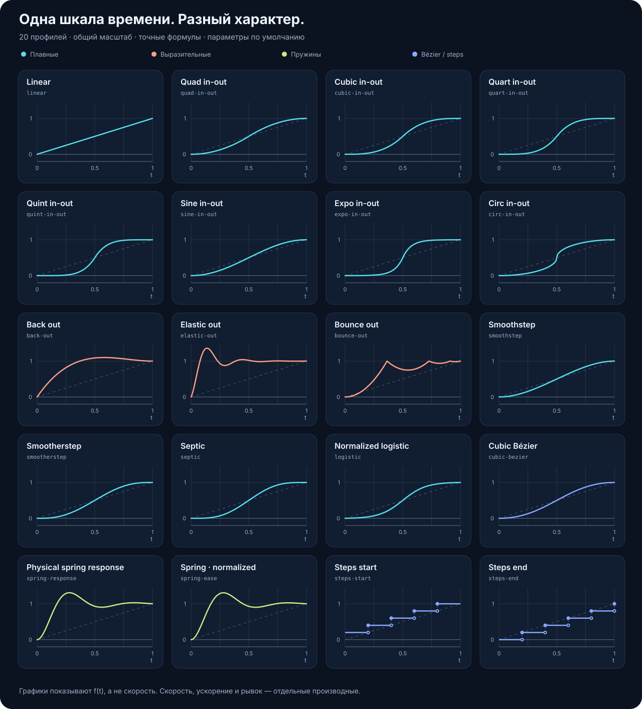

## Как читать

По горизонтали — нормализованное время `t ∈ [0,1]`, по вертикали — значение `f(t)`. Пунктир показывает `linear`. Выход за диапазон 0–1 сохранён. В обзорной галерее использован общий вертикальный масштаб [-0.2, 1.45], в отдельных карточках — [-0.45, 1.45], чтобы также показать отрицательный ход elastic-in. Все карточки рассчитаны при параметрах по умолчанию. У ступеней пунктиром обозначен скачок: диагональный переход между уровнями не подразумевается. Численные min/max на карточках оценены по 1001 отсчёту, это не доказанные экстремумы.

Производные вычисляются аналитически: автоматическое дифференцирование до третьего порядка и неявные производные Bézier. Они относятся к нормализованному `t`. На концах — внутренние односторонние пределы, без подразумеваемого продолжения неподвижностью. `null` обозначает отсутствующую конечную производную; точки склейки распознаются с численной погрешностью 1e-12.

## Важные различия версий

- `expo-*` и `elastic-*` здесь непрерывно нормированы на концах. Это собственные явно определённые варианты, которые не обязаны совпадать с одноимёнными пресетами Penner, GSAP или After Effects.
- `back-in-out` отражает ту же базовую формулу; дополнительный множитель 1.525, встречающийся в классическом варианте Penner, не применяется.
- `spring-response` — физическая модель, её значение в конце окна обычно не равно 1. `spring-ease` делится на значение в конце окна, поэтому перестаёт быть исходным физическим откликом.
- `steps-start` начинается со значения 1/n. Все ступени заданы с CSS before=false; поддержаны только jump-start и jump-end.
- `cubic-bezier` решает x(u)=t; подстановка u=t в общий случай неверна. Диапазоны параметров реестра — поддержанный диапазон этой версии, а не все математически допустимые значения.
- Поля `monotone` и `bounded` с булевым значением описывают базовый/обычный режим семейства; если свойство помечено `parameter-dependent`, проверять его для конкретных параметров. `false` не означает, что никакой набор параметров не даст монотонную/ограниченную кривую.

## Индекс

| ID | Название | Настройка | f(1) по умолчанию |
|---|---|---|---:|
| [linear](#linear) | Линейная | — | 1 |
| [quad-in](#quad-in) | Квадратичная · разгон | — | 1 |
| [quad-out](#quad-out) | Квадратичная · торможение | — | 1 |
| [quad-in-out](#quad-in-out) | Квадратичная · разгон и торможение | — | 1 |
| [cubic-in](#cubic-in) | Кубическая · разгон | — | 1 |
| [cubic-out](#cubic-out) | Кубическая · торможение | — | 1 |
| [cubic-in-out](#cubic-in-out) | Кубическая · разгон и торможение | — | 1 |
| [quart-in](#quart-in) | Четвёртая степень · разгон | — | 1 |
| [quart-out](#quart-out) | Четвёртая степень · торможение | — | 1 |
| [quart-in-out](#quart-in-out) | Четвёртая степень · разгон и торможение | — | 1 |
| [quint-in](#quint-in) | Пятая степень · разгон | — | 1 |
| [quint-out](#quint-out) | Пятая степень · торможение | — | 1 |
| [quint-in-out](#quint-in-out) | Пятая степень · разгон и торможение | — | 1 |
| [sine-in](#sine-in) | Синусоидальная · разгон | — | 1 |
| [sine-out](#sine-out) | Синусоидальная · торможение | — | 1 |
| [sine-in-out](#sine-in-out) | Синусоидальная · разгон и торможение | — | 1 |
| [expo-in](#expo-in) | Нормированная экспонента · разгон | strength | 1 |
| [expo-out](#expo-out) | Нормированная экспонента · торможение | strength | 1 |
| [expo-in-out](#expo-in-out) | Нормированная экспонента · разгон и торможение | strength | 1 |
| [circ-in](#circ-in) | Дуга окружности · разгон | — | 1 |
| [circ-out](#circ-out) | Дуга окружности · торможение | — | 1 |
| [circ-in-out](#circ-in-out) | Дуга окружности · разгон и торможение | — | 1 |
| [back-in](#back-in) | Обратный ход · разгон | overshoot | 1 |
| [back-out](#back-out) | Обратный ход · торможение | overshoot | 1 |
| [back-in-out](#back-in-out) | Обратный ход · разгон и торможение | overshoot | 1 |
| [elastic-in](#elastic-in) | Упругий отклик · разгон | decay, cycles | 1 |
| [elastic-out](#elastic-out) | Упругий отклик · торможение | decay, cycles | 1 |
| [elastic-in-out](#elastic-in-out) | Упругий отклик · разгон и торможение | decay, cycles | 1 |
| [bounce-in](#bounce-in) | Отскоки · разгон | — | 1 |
| [bounce-out](#bounce-out) | Отскоки · торможение | — | 1 |
| [bounce-in-out](#bounce-in-out) | Отскоки · разгон и торможение | — | 1 |
| [smoothstep](#smoothstep) | Мягкий переход C¹ | — | 1 |
| [smootherstep](#smootherstep) | Мягкий переход C² · minimum jerk | — | 1 |
| [septic](#septic) | Седьмая степень · нулевой рывок | — | 1 |
| [logistic](#logistic) | Нормированная логистическая | steepness | 1 |
| [cubic-bezier](#cubic-bezier) | Кубическая Безье | x1, y1, x2, y2 | 1 |
| [spring-response](#spring-response) | Физический отклик пружины | frequency, damping, duration | 1.002 |
| [spring-ease](#spring-ease) | Пружина с нормировкой конца | frequency, damping, duration | 1 |
| [steps-start](#steps-start) | Ступени · скачок в начале | steps | 1 |
| [steps-end](#steps-end) | Ступени · скачок в конце | steps | 1 |

## Карточки

<strong>Linear</strong> — Линейная

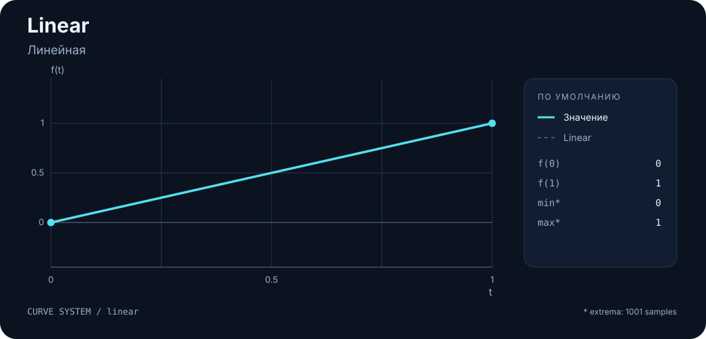

Равномерное изменение значения; ненулевая скорость в начале и конце.

**Формула:** `f(t)=t`

- При продолжении постоянными значениями скорость скачком меняется на границах.

**Ориентиры для семейства:** [источник 1](https://www.w3.org/TR/css-easing-1/). Точная версия задаётся формулой выше.

<strong>Quad in</strong> — Квадратичная · разгон

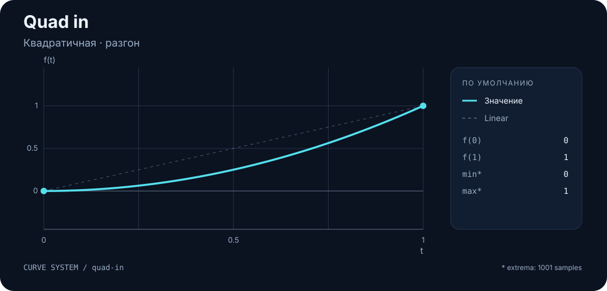

Квадратичная: разгон.

**Формула:** `g(t)=t²; f=g`

**Ориентиры для семейства:** [источник 1](https://easings.net/). Точная версия задаётся формулой выше.

<strong>Quad out</strong> — Квадратичная · торможение

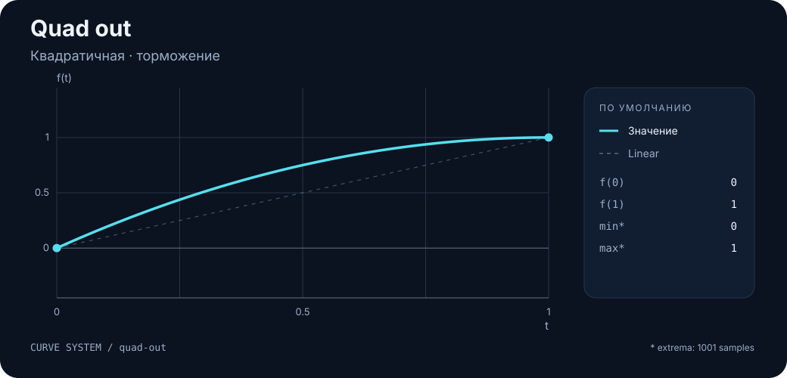

Квадратичная: торможение.

**Формула:** `g(t)=t²; f(t)=1−g(1−t)`

**Ориентиры для семейства:** [источник 1](https://easings.net/). Точная версия задаётся формулой выше.

<strong>Quad in-out</strong> — Квадратичная · разгон и торможение

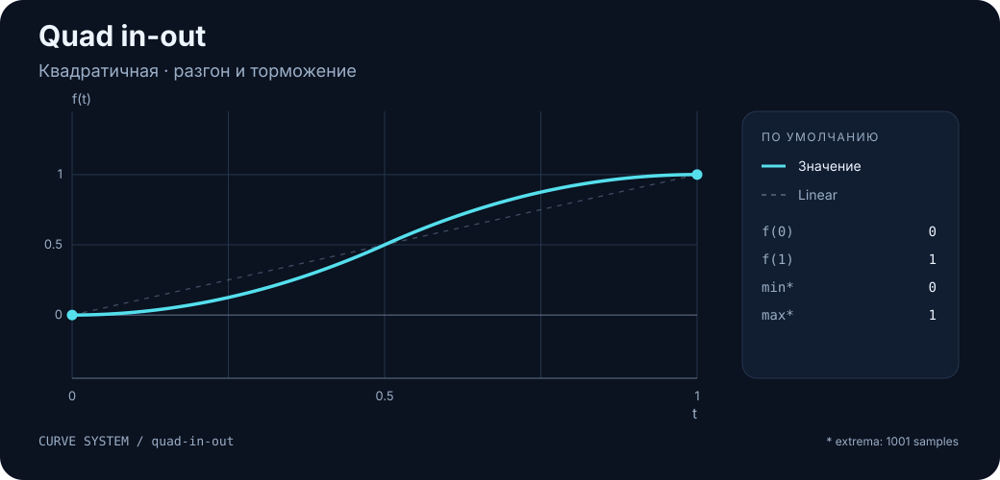

Квадратичная: разгон и торможение.

**Формула:** `g(t)=t²; f(t)=g(2t)/2 if t<1/2; 1−g(2−2t)/2 otherwise`

- Симметричная склейка в t=0.5 не гарантирует непрерывного ускорения.

**Ориентиры для семейства:** [источник 1](https://easings.net/). Точная версия задаётся формулой выше.

<strong>Cubic in</strong> — Кубическая · разгон

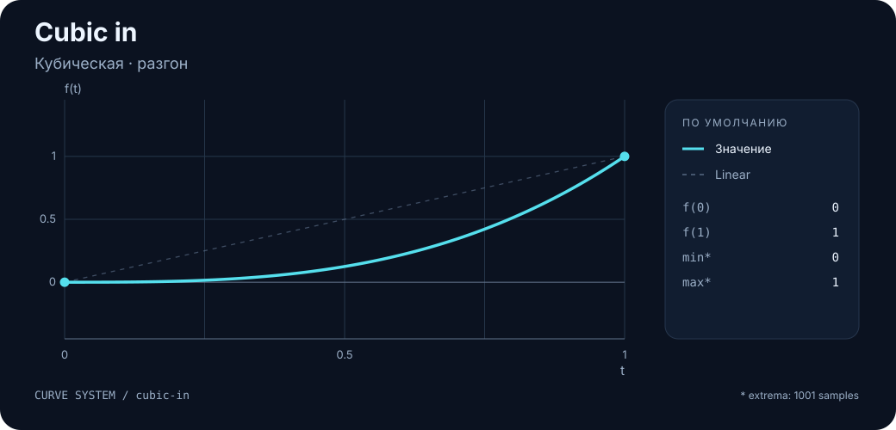

Кубическая: разгон.

**Формула:** `g(t)=t³; f=g`

**Ориентиры для семейства:** [источник 1](https://easings.net/). Точная версия задаётся формулой выше.

<strong>Cubic out</strong> — Кубическая · торможение

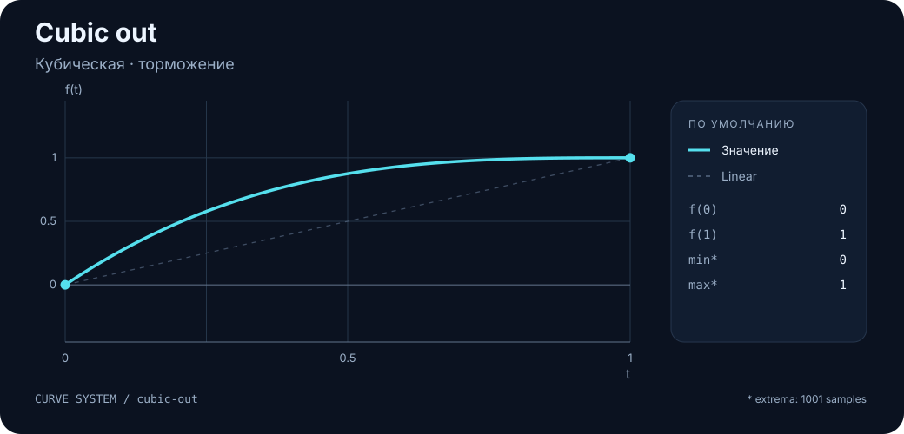

Кубическая: торможение.

**Формула:** `g(t)=t³; f(t)=1−g(1−t)`

**Ориентиры для семейства:** [источник 1](https://easings.net/). Точная версия задаётся формулой выше.

<strong>Cubic in-out</strong> — Кубическая · разгон и торможение

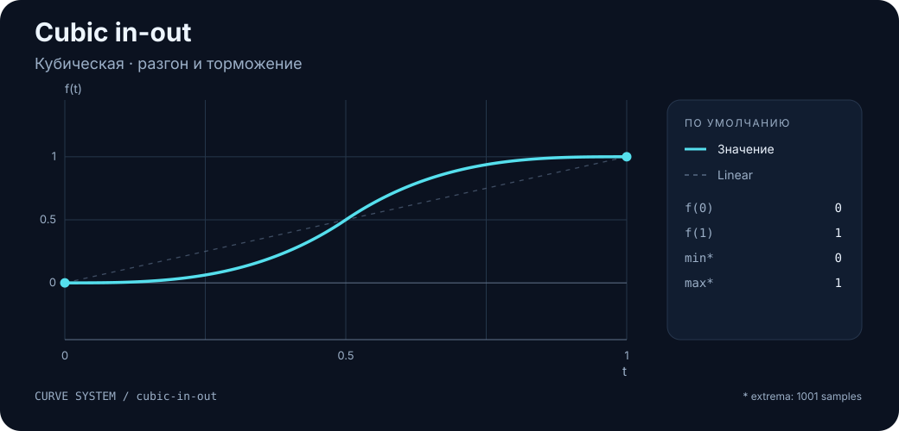

Кубическая: разгон и торможение.

**Формула:** `g(t)=t³; f(t)=g(2t)/2 if t<1/2; 1−g(2−2t)/2 otherwise`

- Симметричная склейка в t=0.5 не гарантирует непрерывного ускорения.

**Ориентиры для семейства:** [источник 1](https://easings.net/). Точная версия задаётся формулой выше.

<strong>Quart in</strong> — Четвёртая степень · разгон

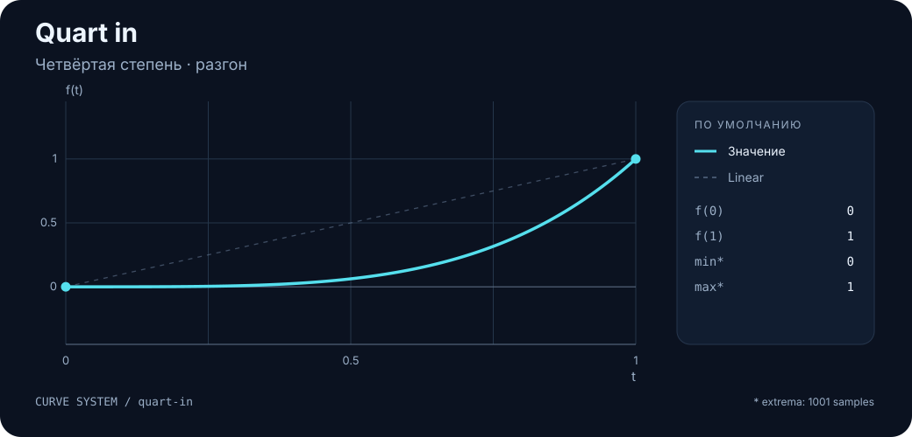

Четвёртая степень: разгон.

**Формула:** `g(t)=t⁴; f=g`

**Ориентиры для семейства:** [источник 1](https://easings.net/). Точная версия задаётся формулой выше.

<strong>Quart out</strong> — Четвёртая степень · торможение

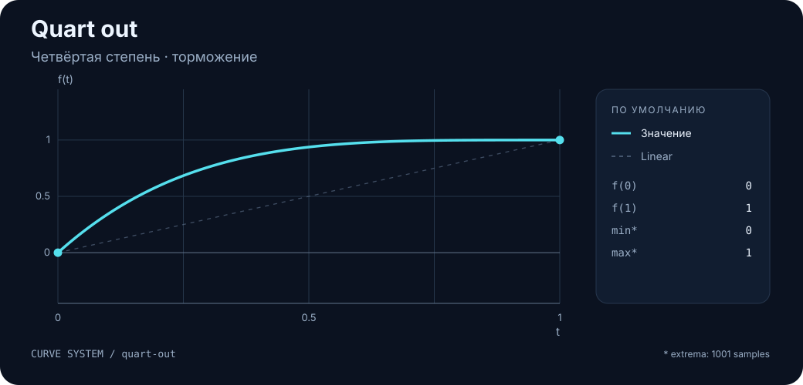

Четвёртая степень: торможение.

**Формула:** `g(t)=t⁴; f(t)=1−g(1−t)`

**Ориентиры для семейства:** [источник 1](https://easings.net/). Точная версия задаётся формулой выше.

<strong>Quart in-out</strong> — Четвёртая степень · разгон и торможение

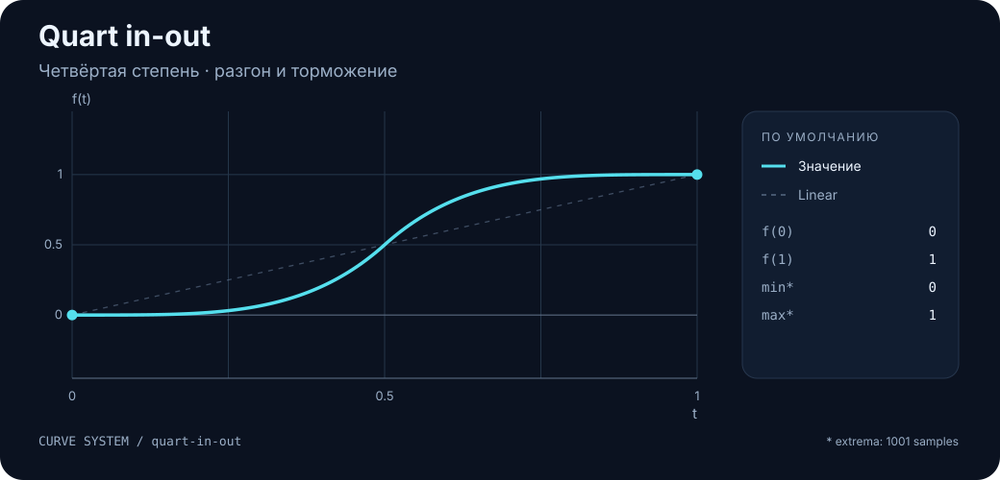

Четвёртая степень: разгон и торможение.

**Формула:** `g(t)=t⁴; f(t)=g(2t)/2 if t<1/2; 1−g(2−2t)/2 otherwise`

- Симметричная склейка в t=0.5 не гарантирует непрерывного ускорения.

**Ориентиры для семейства:** [источник 1](https://easings.net/). Точная версия задаётся формулой выше.

<strong>Quint in</strong> — Пятая степень · разгон

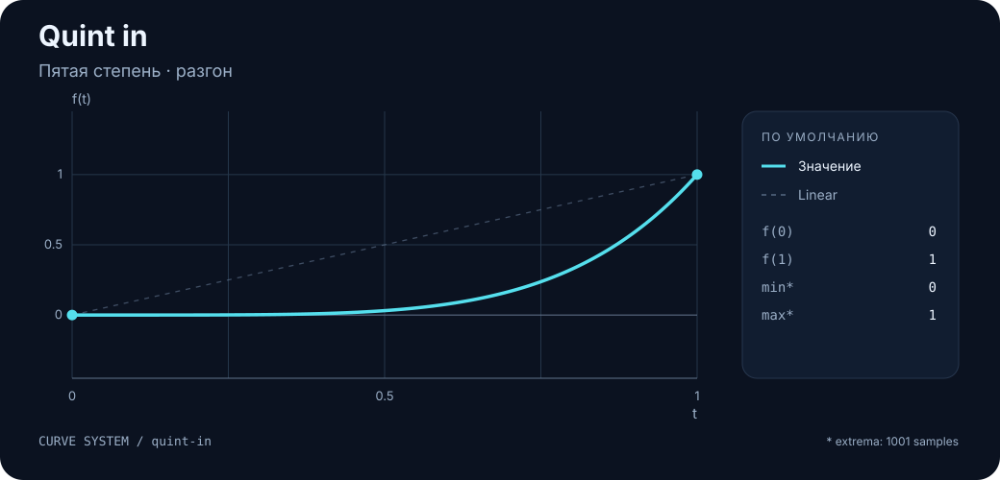

Пятая степень: разгон.

**Формула:** `g(t)=t⁵; f=g`

**Ориентиры для семейства:** [источник 1](https://easings.net/). Точная версия задаётся формулой выше.

<strong>Quint out</strong> — Пятая степень · торможение

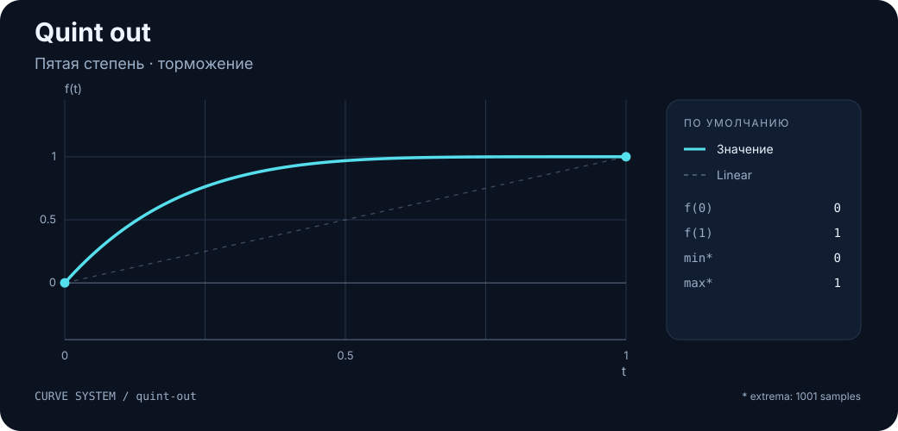

Пятая степень: торможение.

**Формула:** `g(t)=t⁵; f(t)=1−g(1−t)`

**Ориентиры для семейства:** [источник 1](https://easings.net/). Точная версия задаётся формулой выше.

<strong>Quint in-out</strong> — Пятая степень · разгон и торможение

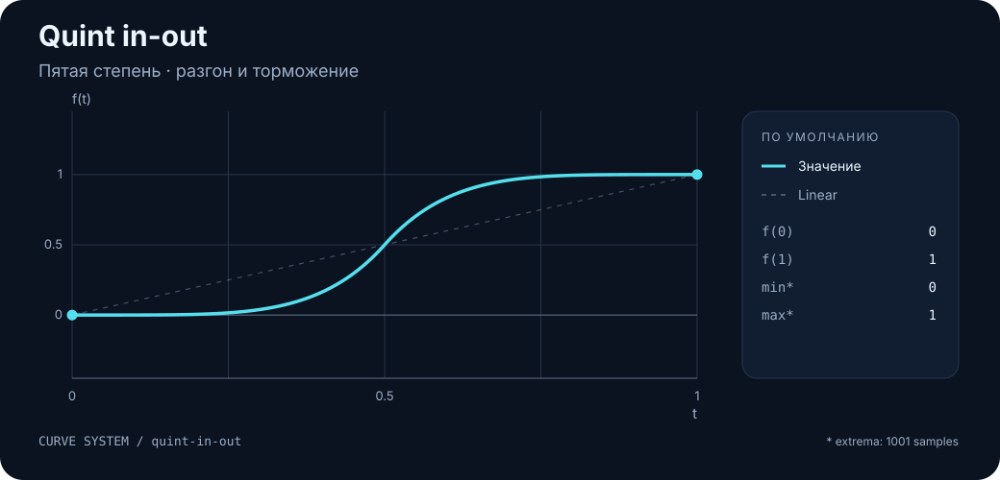

Пятая степень: разгон и торможение.

**Формула:** `g(t)=t⁵; f(t)=g(2t)/2 if t<1/2; 1−g(2−2t)/2 otherwise`

- Симметричная склейка в t=0.5 не гарантирует непрерывного ускорения.

**Ориентиры для семейства:** [источник 1](https://easings.net/). Точная версия задаётся формулой выше.

<strong>Sine in</strong> — Синусоидальная · разгон

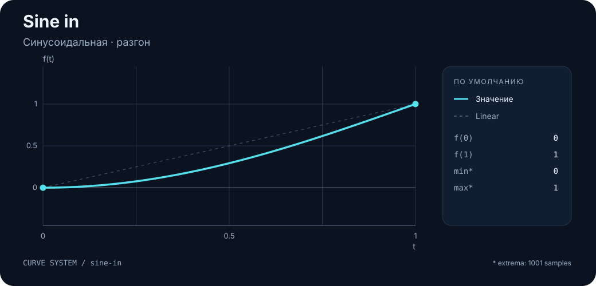

Синусоидальная: разгон.

**Формула:** `g(t)=1−cos(πt/2); f=g`

**Ориентиры для семейства:** [источник 1](https://easings.net/). Точная версия задаётся формулой выше.

<strong>Sine out</strong> — Синусоидальная · торможение

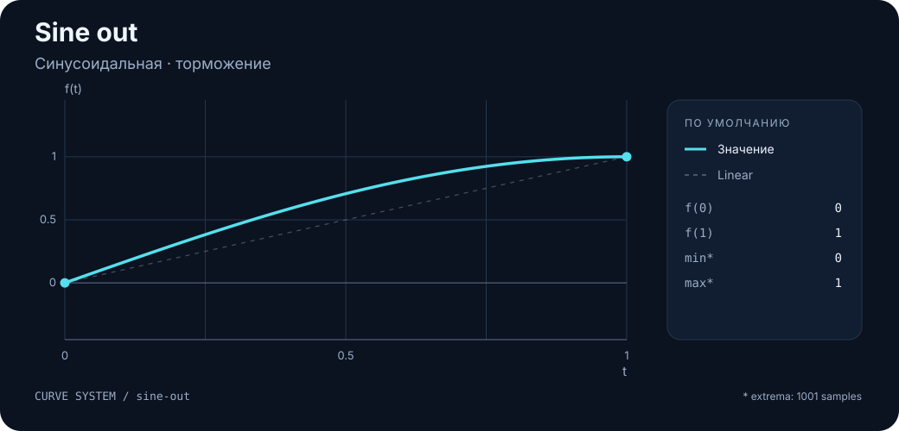

Синусоидальная: торможение.

**Формула:** `g(t)=1−cos(πt/2); f(t)=1−g(1−t)`

**Ориентиры для семейства:** [источник 1](https://easings.net/). Точная версия задаётся формулой выше.

<strong>Sine in-out</strong> — Синусоидальная · разгон и торможение

Синусоидальная: разгон и торможение.

**Формула:** `g(t)=1−cos(πt/2); f(t)=g(2t)/2 if t<1/2; 1−g(2−2t)/2 otherwise`

**Ориентиры для семейства:** [источник 1](https://easings.net/). Точная версия задаётся формулой выше.

<strong>Expo in</strong> — Нормированная экспонента · разгон

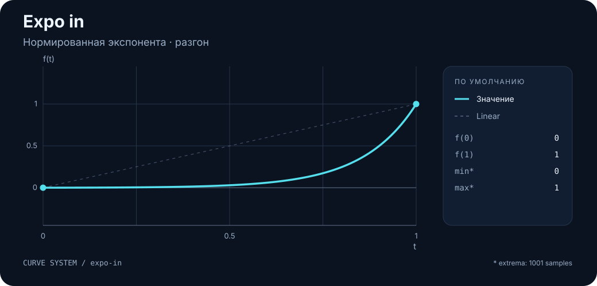

Нормированная экспонента: разгон.

**Формула:** `g(t)=expm1(k·t)/expm1(k); f=g`

| Параметр | Смысл | Диапазон | По умолчанию |
|---|---|---|---:|
| `strength` | Крутизна k | 1…12 | 7 |

- Непрерывная нормированная версия Curve System; не побитовая копия Penner с подстановкой крайних значений.

**Ориентиры для семейства:** [источник 1](https://easings.net/). Точная версия задаётся формулой выше.

<strong>Expo out</strong> — Нормированная экспонента · торможение

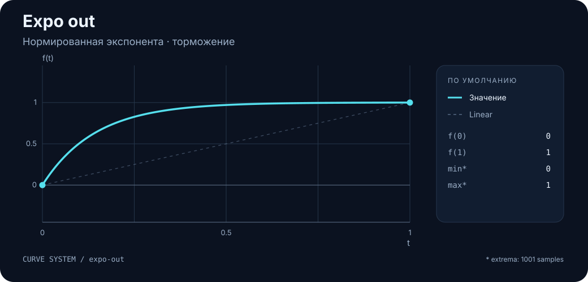

Нормированная экспонента: торможение.

**Формула:** `g(t)=expm1(k·t)/expm1(k); f(t)=1−g(1−t)`

| Параметр | Смысл | Диапазон | По умолчанию |
|---|---|---|---:|
| `strength` | Крутизна k | 1…12 | 7 |

- Непрерывная нормированная версия Curve System; не побитовая копия Penner с подстановкой крайних значений.

**Ориентиры для семейства:** [источник 1](https://easings.net/). Точная версия задаётся формулой выше.

<strong>Expo in-out</strong> — Нормированная экспонента · разгон и торможение

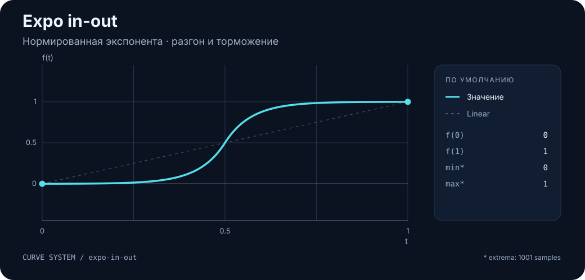

Нормированная экспонента: разгон и торможение.

**Формула:** `g(t)=expm1(k·t)/expm1(k); f(t)=g(2t)/2 if t<1/2; 1−g(2−2t)/2 otherwise`

| Параметр | Смысл | Диапазон | По умолчанию |
|---|---|---|---:|
| `strength` | Крутизна k | 1…12 | 7 |

- Непрерывная нормированная версия Curve System; не побитовая копия Penner с подстановкой крайних значений.
- Симметричная склейка в t=0.5 не гарантирует непрерывного ускорения.

**Ориентиры для семейства:** [источник 1](https://easings.net/). Точная версия задаётся формулой выше.

<strong>Circ in</strong> — Дуга окружности · разгон

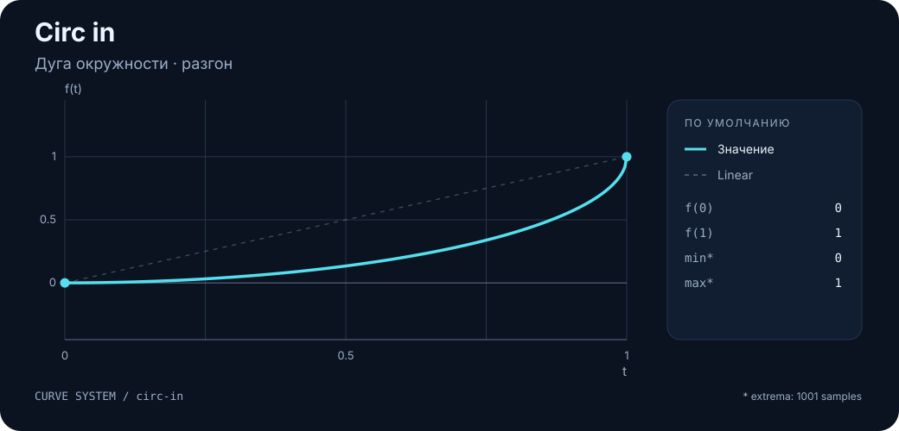

Дуга окружности: разгон.

**Формула:** `g(t)=1−√(1−t²); f=g`

- Вертикальная касательная даёт неограниченные производные в некоторых точках; API возвращает null.

**Ориентиры для семейства:** [источник 1](https://easings.net/). Точная версия задаётся формулой выше.

<strong>Circ out</strong> — Дуга окружности · торможение

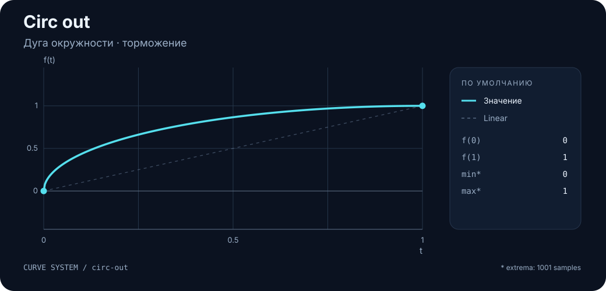

Дуга окружности: торможение.

**Формула:** `g(t)=1−√(1−t²); f(t)=1−g(1−t)`

- Вертикальная касательная даёт неограниченные производные в некоторых точках; API возвращает null.

**Ориентиры для семейства:** [источник 1](https://easings.net/). Точная версия задаётся формулой выше.

<strong>Circ in-out</strong> — Дуга окружности · разгон и торможение

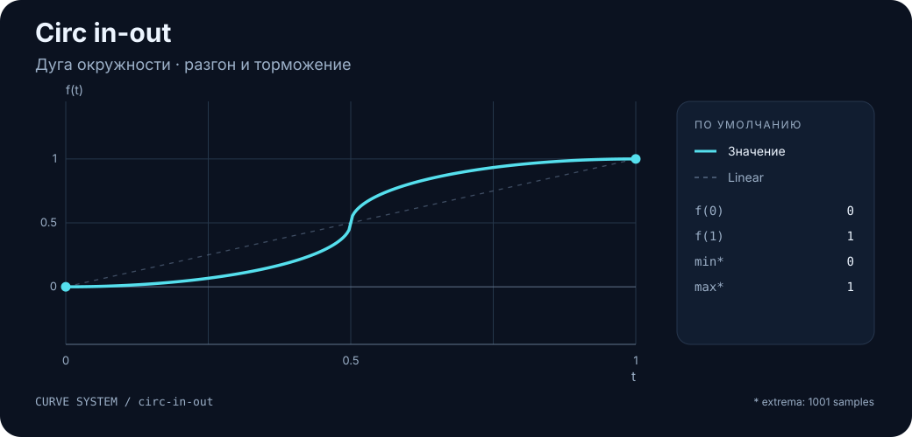

Дуга окружности: разгон и торможение.

**Формула:** `g(t)=1−√(1−t²); f(t)=g(2t)/2 if t<1/2; 1−g(2−2t)/2 otherwise`

- Симметричная склейка в t=0.5 не гарантирует непрерывного ускорения.
- Вертикальная касательная даёт неограниченные производные в некоторых точках; API возвращает null.

**Ориентиры для семейства:** [источник 1](https://easings.net/). Точная версия задаётся формулой выше.

<strong>Back in</strong> — Обратный ход · разгон

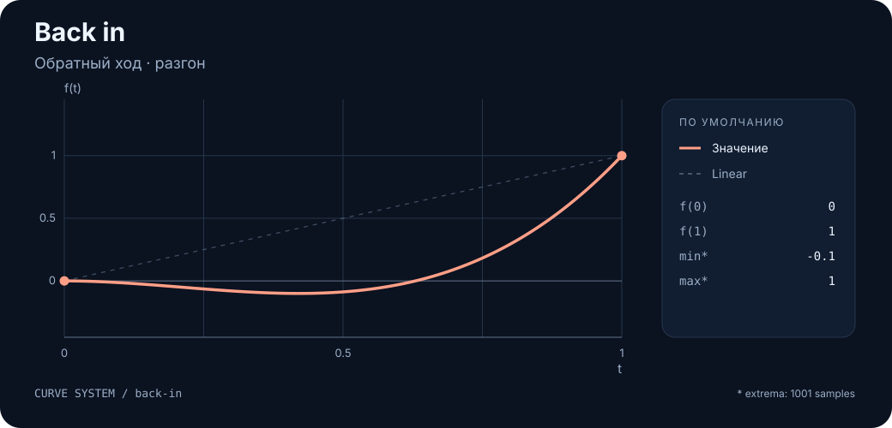

Обратный ход: разгон.

**Формула:** `g(t)=(s+1)t³−s·t²; f=g`

| Параметр | Смысл | Диапазон | По умолчанию |
|---|---|---|---:|
| `overshoot` | Коэффициент s | 0…4 | 1.70158 |

- Выход за [0,1] является частью формы; не обрезать результат автоматически. In-out — симметрия той же g, без дополнительного множителя Penner 1.525.

**Ориентиры для семейства:** [источник 1](https://easings.net/). Точная версия задаётся формулой выше.

<strong>Back out</strong> — Обратный ход · торможение

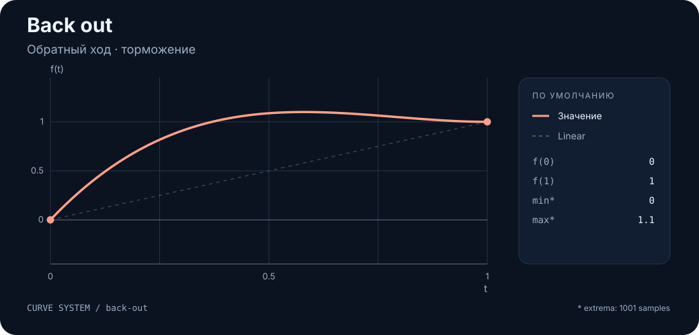

Обратный ход: торможение.

**Формула:** `g(t)=(s+1)t³−s·t²; f(t)=1−g(1−t)`

| Параметр | Смысл | Диапазон | По умолчанию |
|---|---|---|---:|
| `overshoot` | Коэффициент s | 0…4 | 1.70158 |

- Выход за [0,1] является частью формы; не обрезать результат автоматически. In-out — симметрия той же g, без дополнительного множителя Penner 1.525.

**Ориентиры для семейства:** [источник 1](https://easings.net/). Точная версия задаётся формулой выше.

<strong>Back in-out</strong> — Обратный ход · разгон и торможение

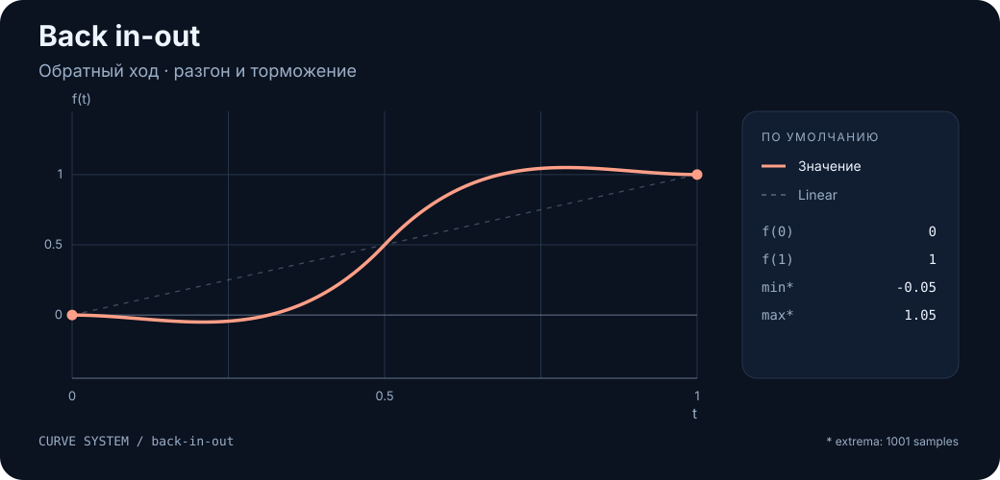

Обратный ход: разгон и торможение.

**Формула:** `g(t)=(s+1)t³−s·t²; f(t)=g(2t)/2 if t<1/2; 1−g(2−2t)/2 otherwise`

| Параметр | Смысл | Диапазон | По умолчанию |
|---|---|---|---:|
| `overshoot` | Коэффициент s | 0…4 | 1.70158 |

- Симметричная склейка в t=0.5 не гарантирует непрерывного ускорения.
- Выход за [0,1] является частью формы; не обрезать результат автоматически. In-out — симметрия той же g, без дополнительного множителя Penner 1.525.

**Ориентиры для семейства:** [источник 1](https://easings.net/). Точная версия задаётся формулой выше.

<strong>Elastic in</strong> — Упругий отклик · разгон

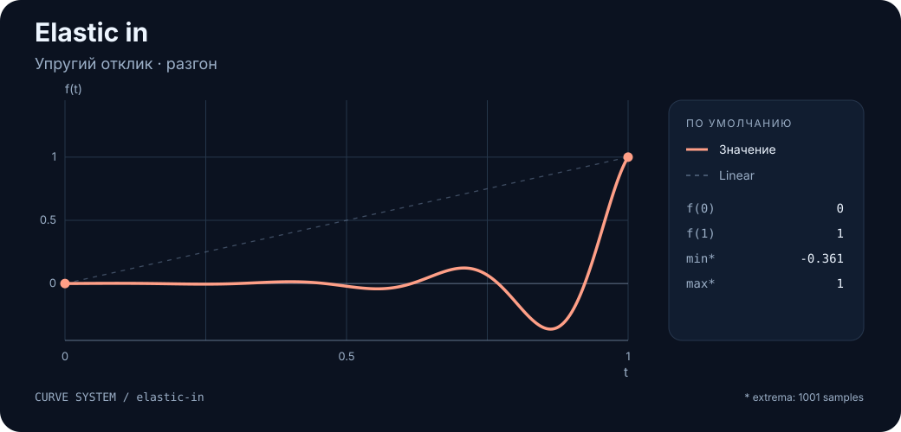

Упругий отклик: разгон.

**Формула:** `g(t)=1−h(1−t); h(t)=(1−exp(−d·t)cos(2πc·t))/(1−exp(−d)cos(2πc)); f=g`

| Параметр | Смысл | Диапазон | По умолчанию |
|---|---|---|---:|
| `decay` | Затухание d | 1…15 | 7 |
| `cycles` | Колебания c | 1…6 | 3.25 |

- Непрерывная нормированная версия Curve System; не побитовая копия Penner с подстановкой крайних значений.
- Затухающий косинус — художественная функция; начальная скорость не обязана быть нулевой. Это не spring-response.

**Ориентиры для семейства:** [источник 1](https://easings.net/). Точная версия задаётся формулой выше.

<strong>Elastic out</strong> — Упругий отклик · торможение

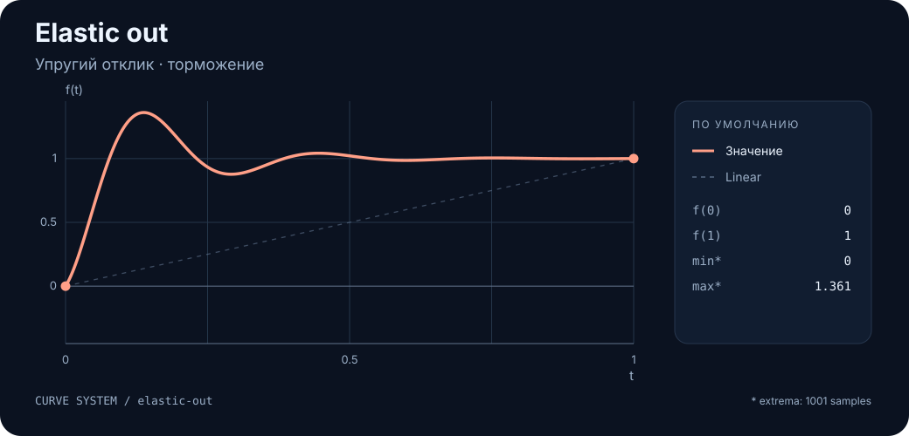

Упругий отклик: торможение.

**Формула:** `g(t)=1−h(1−t); h(t)=(1−exp(−d·t)cos(2πc·t))/(1−exp(−d)cos(2πc)); f(t)=1−g(1−t)`

| Параметр | Смысл | Диапазон | По умолчанию |
|---|---|---|---:|
| `decay` | Затухание d | 1…15 | 7 |
| `cycles` | Колебания c | 1…6 | 3.25 |

- Непрерывная нормированная версия Curve System; не побитовая копия Penner с подстановкой крайних значений.
- Затухающий косинус — художественная функция; начальная скорость не обязана быть нулевой. Это не spring-response.

**Ориентиры для семейства:** [источник 1](https://easings.net/). Точная версия задаётся формулой выше.

<strong>Elastic in-out</strong> — Упругий отклик · разгон и торможение

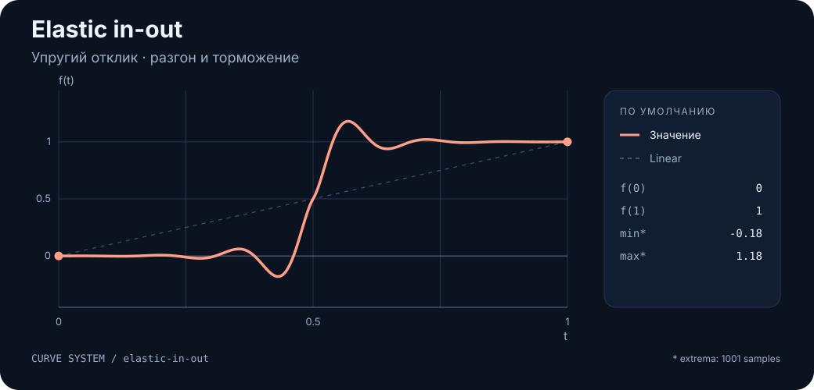

Упругий отклик: разгон и торможение.

**Формула:** `g(t)=1−h(1−t); h(t)=(1−exp(−d·t)cos(2πc·t))/(1−exp(−d)cos(2πc)); f(t)=g(2t)/2 if t<1/2; 1−g(2−2t)/2 otherwise`

| Параметр | Смысл | Диапазон | По умолчанию |
|---|---|---|---:|
| `decay` | Затухание d | 1…15 | 7 |
| `cycles` | Колебания c | 1…6 | 3.25 |

- Непрерывная нормированная версия Curve System; не побитовая копия Penner с подстановкой крайних значений.
- Симметричная склейка в t=0.5 не гарантирует непрерывного ускорения.
- Затухающий косинус — художественная функция; начальная скорость не обязана быть нулевой. Это не spring-response.

**Ориентиры для семейства:** [источник 1](https://easings.net/). Точная версия задаётся формулой выше.

<strong>Bounce in</strong> — Отскоки · разгон

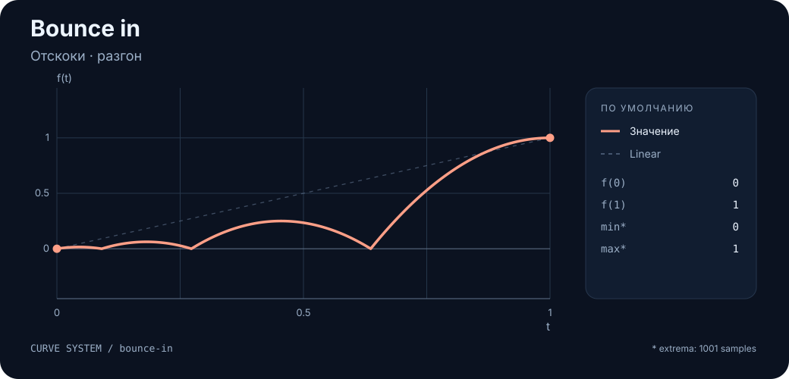

Отскоки: разгон.

**Формула:** `g(t)=1−b(1−t); b(t)=a(t−oᵢ)²+cᵢ, a=121/16 (4 pieces); f=g`

- В точках столкновения скорость имеет скачок; конечные ускорение и рывок там не определены.

**Ориентиры для семейства:** [источник 1](https://easings.net/). Точная версия задаётся формулой выше.

<strong>Bounce out</strong> — Отскоки · торможение

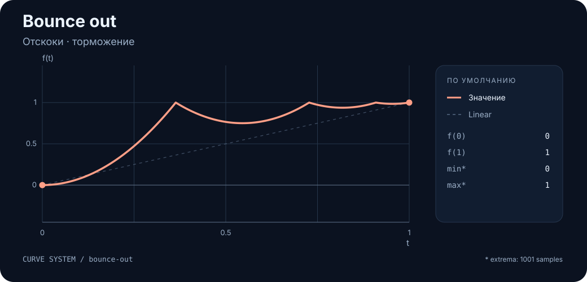

Отскоки: торможение.

**Формула:** `g(t)=1−b(1−t); b(t)=a(t−oᵢ)²+cᵢ, a=121/16 (4 pieces); f(t)=1−g(1−t)`

- В точках столкновения скорость имеет скачок; конечные ускорение и рывок там не определены.

**Ориентиры для семейства:** [источник 1](https://easings.net/). Точная версия задаётся формулой выше.

<strong>Bounce in-out</strong> — Отскоки · разгон и торможение

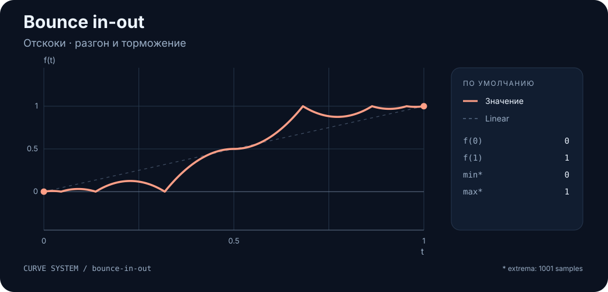

Отскоки: разгон и торможение.

**Формула:** `g(t)=1−b(1−t); b(t)=a(t−oᵢ)²+cᵢ, a=121/16 (4 pieces); f(t)=g(2t)/2 if t<1/2; 1−g(2−2t)/2 otherwise`

- Симметричная склейка в t=0.5 не гарантирует непрерывного ускорения.
- В точках столкновения скорость имеет скачок; конечные ускорение и рывок там не определены.

**Ориентиры для семейства:** [источник 1](https://easings.net/). Точная версия задаётся формулой выше.

<strong>Smoothstep</strong> — Мягкий переход C¹

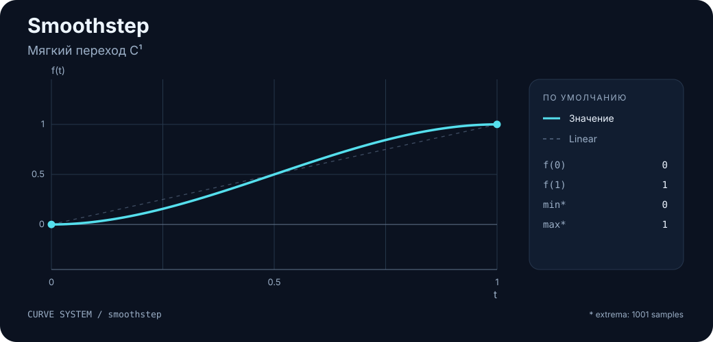

Нулевая скорость по краям; при соединении с неподвижностью ускорение скачет.

**Формула:** `f(t)=3t²−2t³`

**Ориентиры для семейства:** [источник 1](https://registry.khronos.org/OpenGL-Refpages/gl4/html/smoothstep.xhtml). Точная версия задаётся формулой выше.

<strong>Smootherstep / minimum jerk</strong> — Мягкий переход C² · minimum jerk

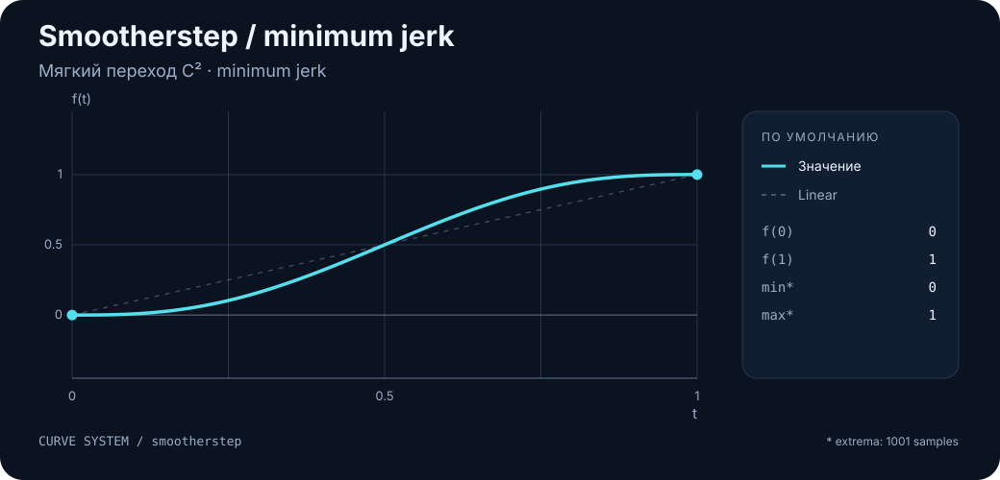

Нулевые скорость и ускорение на концах; подходит для плавного старта и остановки.

**Формула:** `f(t)=10t³−15t⁴+6t⁵`

- Minimum jerk при фиксированных длительности, положениях и нулевых крайних скоростях/ускорениях. Это не универсальная оптимальность движения.

**Ориентиры для семейства:** [источник 1](https://doi.org/10.1523/JNEUROSCI.05-07-01688.1985). Точная версия задаётся формулой выше.

<strong>Septic / zero endpoint jerk</strong> — Седьмая степень · нулевой рывок

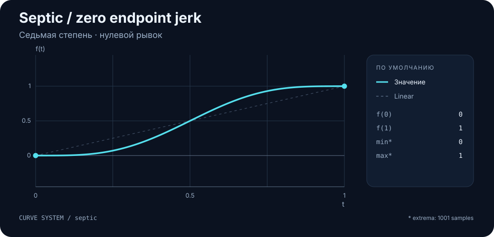

Нулевые первые три производные на концах: соединение с неподвижностью C³.

**Формула:** `f(t)=35t⁴−84t⁵+70t⁶−20t⁷`

- Формула получается из восьми условий: значения 0/1 и нулевые первые три производные на обоих концах. Название septic указывает степень. Оптимальность minimum snap требует явно заданной вариационной задачи.

**Происхождение:** определение и вывод из указанных граничных условий в этом проекте.

<strong>Normalized logistic</strong> — Нормированная логистическая

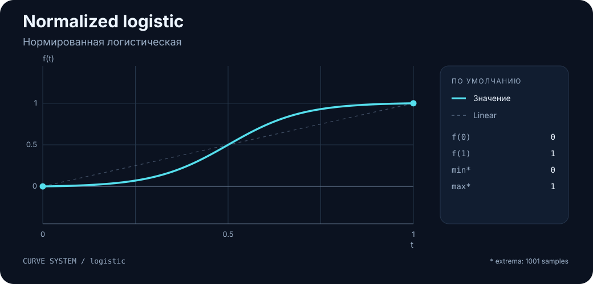

Управляемая S-форма. Значения в концах нормированы, но скорости там обычно ненулевые.

**Формула:** `f(t)=(σ(k(t−1/2))−σ(−k/2))/(σ(k/2)−σ(−k/2)); σ(x)=1/(1+e⁻ˣ)`

| Параметр | Смысл | Диапазон | По умолчанию |
|---|---|---|---:|
| `steepness` | Крутизна k | 1…16 | 10 |

- Самостоятельно нормированное определение логистической функции; соответствие конкретной внешней библиотеке не заявлено.

**Происхождение:** определение и вывод из указанных граничных условий в этом проекте.

<strong>Cubic Bézier</strong> — Кубическая Безье

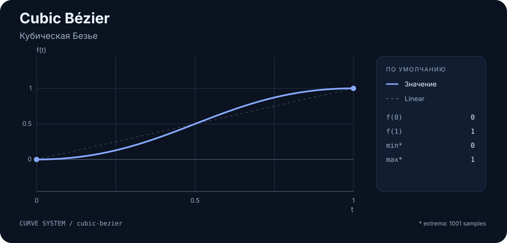

Редактируемая временная кривая с двумя контрольными точками; время инвертируется численно.

**Формула:** `f(t)=Bᵧ(u), where Bₓ(u)=t; P₀=(0,0),P₃=(1,1)`

| Параметр | Смысл | Диапазон | По умолчанию |
|---|---|---|---:|
| `x1` | x₁ | 0…1 | 0.42 |
| `y1` | y₁ | -2…3 | 0 |
| `x2` | x₂ | 0…1 | 0.58 |
| `y2` | y₂ | -2…3 | 1 |

- Ограничение y в [-2,3] — диапазон редактора этой версии; CSS допускает произвольные конечные y.
- Производная при вырожденном dx/du может быть бесконечной. Равные x/y координаты распознаются как точная linear.

**Ориентиры для семейства:** [источник 1](https://www.w3.org/TR/css-easing-1/). Точная версия задаётся формулой выше.

<strong>Physical spring response</strong> — Физический отклик пружины

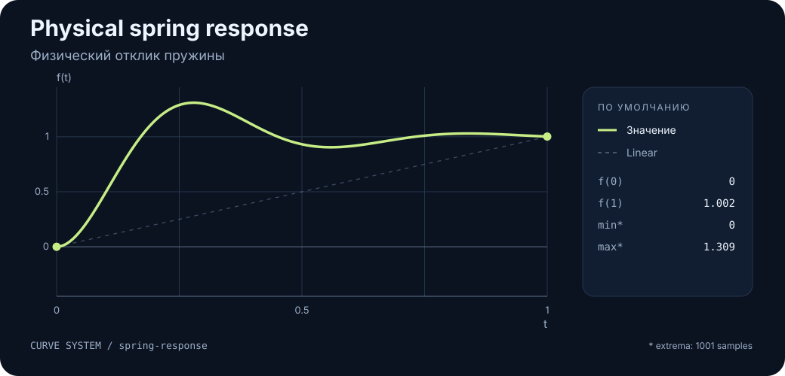

Аналитический ответ системы второго порядка. Конец окна — не обязательно целевое значение.

**Формула:** `s″(τ)+2ζωs′(τ)+ω²(s(τ)−1)=0; s(0)=s′(0)=0; f(t)=s(Tt)`

| Параметр | Смысл | Диапазон | По умолчанию |
|---|---|---|---:|
| `frequency` | Собственная частота ω, рад/с | 1…30 | 12 |
| `damping` | Коэффициент затухания ζ | 0.05…2 | 0.35 |
| `duration` | Горизонт T, с | 0.1…3 | 1 |

- T — физический горизонт в секундах. API производных дифференцирует по t, поэтому содержит множители Tⁿ.
- Нет переключения цели, начальной скорости и stateful-интегратора; это одиночный step response.

**Ориентиры для семейства:** [источник 1](https://ocw.mit.edu/courses/18-03sc-differential-equations-fall-2011/pages/unit-ii-second-order-constant-coefficient-linear-equations/damped-harmonic-oscillators/). Точная версия задаётся формулой выше.

<strong>Endpoint-normalized spring</strong> — Пружина с нормировкой конца

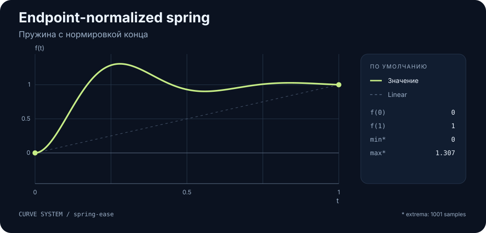

Пружинная форма на фиксированном интервале с точными значениями 0 и 1.

**Формула:** `f(t)=s(Tt)/s(T), with s from spring-response`

| Параметр | Смысл | Диапазон | По умолчанию |
|---|---|---|---:|
| `frequency` | Собственная частота ω, рад/с | 1…30 | 12 |
| `damping` | Коэффициент затухания ζ | 0.05…2 | 0.35 |
| `duration` | Горизонт T, с | 0.1…3 | 1 |

- Нормировка меняет физический отклик и не обнуляет конечную скорость. Не выдавать эту функцию за исходный spring-response.

**Ориентиры для семейства:** [источник 1](https://ocw.mit.edu/courses/18-03sc-differential-equations-fall-2011/pages/unit-ii-second-order-constant-coefficient-linear-equations/damped-harmonic-oscillators/). Точная версия задаётся формулой выше.

<strong>Steps start</strong> — Ступени · скачок в начале

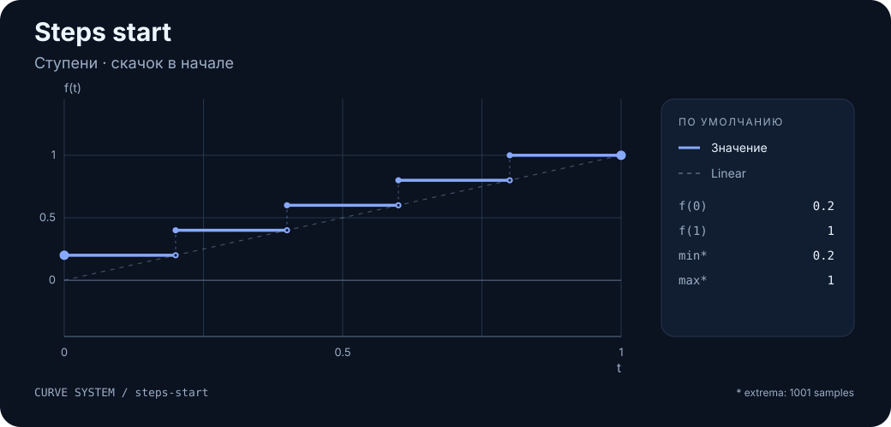

Дискретное переключение состояний. Между скачками производные равны нулю.

**Формула:** `f(t)=min(1,(floor(n·t)+1)/n)`

| Параметр | Смысл | Диапазон | По умолчанию |
|---|---|---|---:|
| `steps` | Число ступеней n | 1…24 (целое) | 5 |

- Реализованы jump-start/jump-end при before=false на [0,1]; это не полная модель CSS fill/before.
- f(0)=1/n: первая ступень появляется сразу.

**Ориентиры для семейства:** [источник 1](https://www.w3.org/TR/css-easing-1/). Точная версия задаётся формулой выше.

<strong>Steps end</strong> — Ступени · скачок в конце

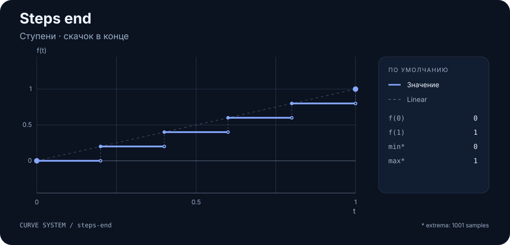

Дискретное переключение состояний. Между скачками производные равны нулю.

**Формула:** `f(t)=floor(n·t)/n`

| Параметр | Смысл | Диапазон | По умолчанию |
|---|---|---|---:|
| `steps` | Число ступеней n | 1…24 (целое) | 5 |

- Реализованы jump-start/jump-end при before=false на [0,1]; это не полная модель CSS fill/before.
- f(1)=1: последний скачок происходит в конце.

**Ориентиры для семейства:** [источник 1](https://www.w3.org/TR/css-easing-1/). Точная версия задаётся формулой выше.

## Значение и производные

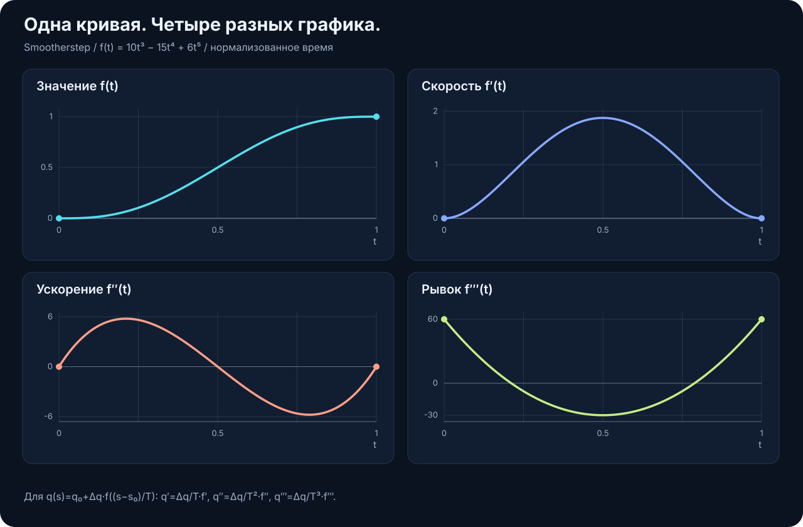

Сопоставлять формы следует при одинаковых начальном/конечном значениях и длительности. Если анимация превращается в пространственную траекторию, отдельно учитывать геометрию пути и параметризацию по длине дуги.
