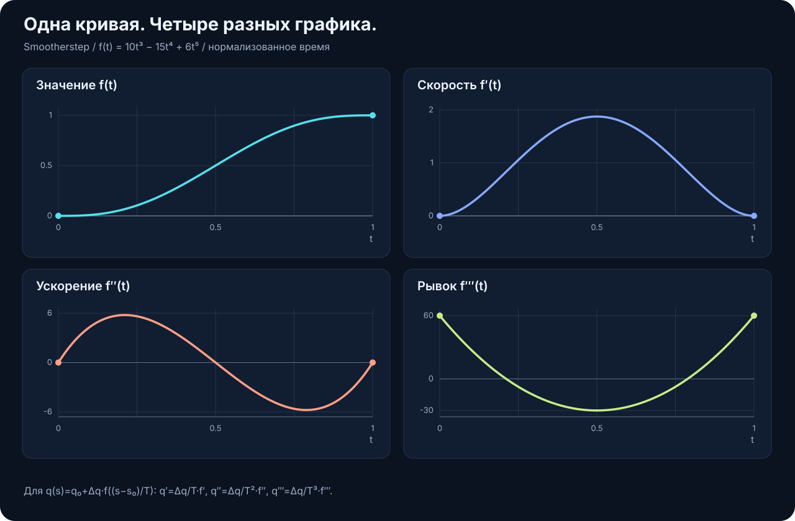

# Математический справочник Curve System

**Версия документа:** 0.1 · **проверка источников:** 24 ноября 2026 года.

Этот справочник задает математические соглашения для чтения, реализации и проверки кривых. Он охватывает больше моделей, чем минимальное вычислительное ядро. Наличие формулы здесь само по себе не означает наличие готового адаптера или функции в коде.

**Навигация:** [исследовательское эссе](../research/01-curve-atlas.md) · [главная](../README.md).

## 1. Обозначения и единицы

| Символ | Значение |
|---|---|
| $s$ | физическое время, например секунды |
| $T>0$ | длительность перехода в тех же единицах |
| $\tau=(s-s_0)/T$ | безразмерное нормированное время |
| $f(\tau)$ | нормированный прогресс |
| $q_0,q_1$ | начальное и конечное значения |
| $\Delta q=q_1-q_0$ | амплитуда изменения |
| $u$ | собственный параметр геометрической кривой, не обязательно время |
| $f', f'', f'''$ | производные по $\tau$ |
| $\dot q,\ddot q,\dddot q$ | производные по физическому времени |

Для скалярного перехода:

$$
q(s)=q_0+\Delta q\,f(\tau),\qquad
q^{(r)}(s)=\frac{\Delta q}{T^r}f^{(r)}(\tau).
$$

Если $q$ задан в пикселях, скорость измеряется в px/s, ускорение — в px/s², рывок — в px/s³. При $q_1<q_0$ скорость отрицательна. Ее модуль — отдельная величина.

Для пространственного вектора speed равна $\|\dot{\mathbf q}\|$, а velocity содержит направление. Такое различие есть и в [выражениях After Effects](https://helpx.adobe.com/after-effects/desktop/work-with-expressions/expression-language-reference/expression-language-reference.html). График $f'$ нельзя без подписей объявлять графиком пространственной скорости произвольного маршрута.

## 2. Договор о границах

Обычный переход удовлетворяет $f(0)=0,\ f(1)=1$. Это не требование ко всем типам объектов: огибающая может идти 0 → 0, а steps с начальным скачком имеет другое значение в начале.

Вне [0,1] нужно выбрать явную политику:

- **Clamp:** удерживать 0 до старта и 1 после окончания.
- **Продолжение касательной:** сохранять крайний наклон.
- **Продолжение формулы:** вычислять выражение за пределами основного интервала, если оно там определено.
- **Loop / ping-pong:** преобразовывать время с отдельной проверкой стыков.
- **Ошибка:** отклонять вход вне области определения.

У [CSS easing](https://www.w3.org/TR/css-easing-2/) существуют собственные правила экстраполяции и граничные соглашения. Clamp может быть контрактом внутреннего API, но его нельзя автоматически называть полным CSS-совместимым вычислением.

При clamp непрерывность $C^k$ требует, чтобы производные порядков 1…$k$ на обоих концах совпадали с нулем удерживающих участков. Интерьер полинома и склеенная анимация имеют разные классы гладкости.

## 3. Основные аналитические семейства

Ниже $\tau\in[0,1]$. Параметры должны быть конечными числами.

| Форма | Формула | Ограничение / замечание |
|---|---|---|
| Linear | $\tau$ | ненулевая скорость на концах |
| Power-in | $\tau^p$ | $p>0$; при $0<p<1$ бесконечный крайний наклон |
| Sine-in | $1-\cos(\pi\tau/2)$ | мягкий старт |
| Sine-out | $\sin(\pi\tau/2)$ | мягкое завершение |
| Sine-in-out | $(1-\cos\pi\tau)/2$ | нулевые крайние скорости |
| Circular-in | $1-\sqrt{1-\tau^2}$ | $f'\to+\infty$ при $\tau\to1^-$ |
| Exponential-in | $(e^{k\tau}-1)/(e^k-1)$ | $k\ne0$; непрерывный предел при $k=0$ равен $\tau$ |
| Back-in | $(a+1)\tau^3-a\tau^2$ | обычно $a\ge0$; отрицательный участок при $a>0$ |
| Smoothstep | $3\tau^2-2\tau^3$ | clamp дает $C^1$ |
| Smootherstep | $10\tau^3-15\tau^4+6\tau^5$ | clamp дает $C^2$ |
| Septic smoothstep | $35\tau^4-84\tau^5+70\tau^6-20\tau^7$ | clamp дает $C^3$ |

Для экспоненты при небольшом $k$ лучше вычислять отношение через expm1, чтобы не вычитать близкие числа. При очень большом положительном $k$ нужна эквивалентная форма без переполнения или документированный предел параметра. Это численная политика реализации, а не изменение математической функции.

Классические семейства и соглашения библиотек можно сверять с [D3](https://d3js.org/d3-ease). Точное определение кубического smoothstep приведено у [Khronos](https://github.khronos.org/Vulkan-Site/glsl/latest/chapters/builtinfunctions.html).

### Преобразования направления

Для базовой формы $g$:

$$
\operatorname{out}[g](\tau)=1-g(1-\tau),
$$

$$
\operatorname{inout}[g](\tau)=
\begin{cases}
g(2\tau)/2,&0\le\tau<1/2,\\
1-g(2-2\tau)/2,&1/2\le\tau\le1.
\end{cases}
$$

Условия производных нужно проверять и в $\tau=1/2$. В частности, степенной in-out при $p>1$ имеет скачок ускорения в середине. Название семейства не гарантирует $C^2$.

## 4. Производные smoothstep и задача minimum jerk

Графики используют нормированное время; численные значения производных не являются скоростью в пикселях в секунду без учета амплитуды и длительности.

Для кубической формы:

$$
S_1'=6\tau(1-\tau),\quad
S_1''=6-12\tau,\quad
S_1'''=-12.
$$

Для квинтической:

$$
S_2'=30\tau^2(1-\tau)^2,
$$

$$
S_2''=60\tau(1-\tau)(1-2\tau),
$$

$$
S_2'''=60(1-6\tau+6\tau^2).
$$

У квинтической формы $\max|S_2'|=15/8$, $\max|S_2''|=10/\sqrt3$, $\max|S_2'''|=60$ на основном интервале. После clamp рывок имеет скачки у границ, но ускорение остается непрерывным.

Минимизация $\int_0^T(\dddot q)^2ds$ при фиксированном $T$, заданных крайних положениях и нулевых крайних скорости и ускорении дает $S_2$. Постановка связана с [Flash & Hogan, 1985](https://doi.org/10.1523/JNEUROSCI.05-07-01688.1985); приведенное решение получается из $q^{(6)}=0$ и шести граничных условий.

Нельзя убрать условие фиксированного времени: стоимость масштабируется как $\Delta q^2/T^5$, поэтому при неограниченном увеличении длительности она стремится к нулю. Minimum jerk и minimum time — разные задачи.

Септическая форма минимизирует квадрат четвертой производной в аналогичной одноинтервальной задаче с фиксированными крайними производными до третьего порядка. Ее производная равна:

$$
S_3'=140\tau^3(1-\tau)^3.
$$

Обобщение:

$$
S_m(\tau)=
\frac{1}{B(m+1,m+1)}
\int_0^\tau u^m(1-u)^mdu,
$$

$$
S_m'=\frac{(2m+1)!}{(m!)^2}\tau^m(1-\tau)^m.
$$

Это частный случай регуляризованной неполной beta-функции; определение сверено с [SciPy betainc](https://docs.scipy.org/doc/scipy/reference/generated/scipy.special.betainc.html). При неравных параметрах $a,b$ получается асимметричная форма.

## 5. Нормированная сигмоида

Для logistic $\sigma(z)=1/(1+e^{-z})$, крутизны $k>0$ и центра $c$:

$$
f(\tau)=
\frac{\sigma(k(\tau-c))-\sigma(-kc)}
{\sigma(k(1-c))-\sigma(-kc)}.
$$

Такое преобразование обеспечивает точные математические значения 0 и 1 на границах. Оно **не** обеспечивает нулевые крайние производные. При $k\to0$ предел равен $\tau$; прямая численная запись может терять точность. При насыщении logistic знаменатель тоже может стать непригодным для вычисления, поэтому нужны ограничения параметров или устойчивая реализация.

Такая форма удобна для управляемого перехода с заданным центром. Если нужны гарантированно нулевые производные у удержаний, сначала следует проверить smoothstep/beta или сконструировать отдельные крайние участки.

## 6. Cubic Bézier: время необходимо обратить

Для концов $P_0=(0,0)$, $P_3=(1,1)$ и контролей $P_1=(x_1,y_1)$, $P_2=(x_2,y_2)$:

$$
X(u)=3(1-u)^2ux_1+3(1-u)u^2x_2+u^3,
$$

$$
Y(u)=3(1-u)^2uy_1+3(1-u)u^2y_2+u^3.
$$

Искомое значение — $f(\tau)=Y(u)$, где $X(u)=\tau$. У CSS $x_1,x_2\in[0,1]$; требование $x_1\le x_2$ не обязательно. Первоисточник: [W3C cubic-bezier](https://www.w3.org/TR/css-easing-2/#cubic-bezier-easing-functions).

Для $X'(u)\ne0$:

$$
f'=\frac{Y'}{X'},\qquad
f''=\frac{Y''X'-Y'X''}{(X')^3},
$$

$$
f'''=
\frac{Y'''(X')^2-Y'X'''X'-3Y''X'X''+3Y'(X'')^2}
{(X')^5}.
$$

Все производные справа берутся по $u$. При $X'=0$ нужен анализ предела, а не механическое деление. Возможна как настоящая сингулярность, так и устранимая неопределенность.

Практический алгоритм: хранить интервал решения; использовать шаг Ньютона, только когда производная достаточна и шаг остается внутри интервала; иначе выполнять бисекцию. Затем проверить остаток $X(u)-\tau$. Для оценки ошибки выходного значения учитывать чувствительность $Y'/X'$.

## 7. Hermite и стыковка сегментов

Кубический сегмент с крайними значениями $q_0,q_1$, физическими скоростями $v_0,v_1$ и длительностью $T$:

$$
q(\tau)=h_{00}q_0+h_{10}Tv_0+h_{01}q_1+h_{11}Tv_1,
$$

где

$$
h_{00}=2\tau^3-3\tau^2+1,\quad
h_{10}=\tau^3-2\tau^2+\tau,
$$

$$
h_{01}=-2\tau^3+3\tau^2,\quad
h_{11}=\tau^3-\tau^2.
$$

Множитель $T$ необходим, потому что базис использует нормированное время. Для двух сегментов с амплитудами $\Delta q_L,\Delta q_R$ и длительностями $T_L,T_R$ условие согласования скорости:

$$
\frac{\Delta q_L}{T_L}f_L'(1)
=
\frac{\Delta q_R}{T_R}f_R'(0).
$$

Для ускорения аналогично используются $\Delta q/T^2$ и вторые производные. Равные нормированные наклоны сами по себе недостаточны.

[PCHIP](https://docs.scipy.org/doc/scipy/reference/generated/scipy.interpolate.PchipInterpolator.html) подходит для сохранения монотонности данных, но не гарантирует непрерывность ускорения. [CubicSpline](https://docs.scipy.org/doc/scipy/reference/generated/scipy.interpolate.CubicSpline.html) дает $C^2$, но требует выбора крайних условий и отдельной проверки диапазона.

## 8. Пружинный отклик

Модель при постоянной цели:

$$
m\ddot x+c\dot x+k(x-x_\ast)=0,\quad
\omega_n=\sqrt{k/m},\quad
\zeta=\frac{c}{2\sqrt{km}}.
$$

Для $x(0)=0,\dot x(0)=0,x_\ast=1$:

| Режим | Отклик |
|---|---|
| $0\le\zeta<1$ | $1-e^{-\zeta\omega_ns}[\cos(\omega_ds)+\zeta\sin(\omega_ds)/\sqrt{1-\zeta^2}]$, $\omega_d=\omega_n\sqrt{1-\zeta^2}$ |
| $\zeta=1$ | $1-(1+\omega_ns)e^{-\omega_ns}$ |
| $\zeta>1$ | $1-[r_2e^{r_1s}-r_1e^{r_2s}]/(r_2-r_1)$, $r_{1,2}=-\omega_n(\zeta\mp\sqrt{\zeta^2-1})$ |

У недемпфированной системы $\zeta=0$ колебания не затухают. Вблизи $\zeta=1$ прямые формулы могут терять точность; нужна устойчивая обработка предельного режима.

Конечный easing можно определить как:

$$
F(\tau)=\frac{x(T\tau)-x(0)}{x(T)-x(0)}.
$$

Перед этим проверить знаменатель. Такое преобразование в общем случае меняет физический смысл амплитуды и не зануляет скорость в $T$. Полное сохранение состояния при смене цели требует использования текущих $x,\dot x$, а не повторного запуска ответа из покоя.

## 9. Отскоки и ступени

Распространенный bounce-out задается четырьмя параболами. При $n=121/16$:

$$
B(\tau)=
\begin{cases}
n\tau^2,&\tau<4/11,\\
n(\tau-6/11)^2+3/4,&\tau<8/11,\\
n(\tau-9/11)^2+15/16,&\tau<10/11,\\
n(\tau-21/22)^2+63/64,&\text{иначе}.
\end{cases}
$$

Форма соответствует [реализации D3 bounce](https://github.com/d3/d3-ease/blob/main/src/bounce.js). Значение непрерывно, производная на точках отскока меняется скачком. По обе стороны события можно вычислить скорость, но единой обычной производной в самой точке нет.

Упрощенный правосторонний steps-end на основном интервале:

$$
f(\tau)=\min(1,\lfloor N\tau\rfloor/N),\qquad N\in\mathbb N.
$$

Это иллюстрация одного соглашения, а не замена всех вариантов CSS steps и их before flag. Производная ступенчатой функции равна нулю между событиями и не определена в точках скачков. Усредненная численная производная может нарисовать пики, высота которых зависит от шага выборки.

## 10. Композиция, инверсия и движение по маршруту

Для композиции $h=f\circ g$:

$$
h'=f'(g)g',\quad
h''=f''(g)(g')^2+f'(g)g'',
$$

$$
h'''=f'''(g)(g')^3+3f''(g)g'g''+f'(g)g'''.
$$

Следовательно, последовательное применение двух «мягких» easing не гарантирует желаемых пиковых ускорений. Нужно учитывать и область значений внутренней функции: overshoot может вывести аргумент внешней за ее область определения.

Обратная функция однозначна при строгой монотонности. При полках следует определить, нужен ли первый или последний момент достижения значения. При overshoot и отскоках корней может быть несколько; операция inverse должна возвращать множество решений или использовать явно заданное правило выбора.

Для маршрута $\mathbf r(u)$, пройденного через $u=f(\tau)$, физическая скорость равна $\mathbf r'(u)f'/T$. Равномерное прохождение расстояния требует обращения функции длины дуги. Полная параметризация с кинематическими ограничениями — отдельная задача; пример научной постановки: [TOPPRA, 2018](https://doi.org/10.1109/TRO.2018.2819195).

## 11. Огибающие и аудио

Hann $w(\tau)=(1-\cos2\pi\tau)/2$ — окно 0 → 0; sine-in-out — переход 0 → 1. Похожая тригонометрическая запись не делает их взаимозаменяемыми. Дискретные варианты Hann различаются способом обращения с концами; см. [SciPy hann](https://docs.scipy.org/doc/scipy/reference/generated/scipy.signal.windows.hann.html).

Для независимых сигналов равной мощности пара $g_1=\cos(\pi\tau/2)$, $g_2=\sin(\pi\tau/2)$ сохраняет ожидаемую мощность смеси. Для одинаковых синфазных сигналов нужно учитывать сумму коэффициентов. Ни один crossfade не гарантирует одинаковой воспринимаемой громкости для любых материалов.

Экспоненциальный ramp положительного параметра:

$$
v(\tau)=V_0(V_1/V_0)^\tau.
$$

Здесь значение не нормируется обычной линейной интерполяцией амплитуды. Для точного нуля и смены знака требуется отдельная политика; стандартный пример ограничений — [Web Audio API](https://www.w3.org/TR/webaudio/#dom-audioparam-exponentialramptovalueattime).

## 12. Контроль корректности

Перед объявлением новой кривой проверять свойства, которые заявлены ее контрактом:

1. **Область:** допустимые параметры, конечные входы, явное поведение вне интервала.
2. **Края:** значения, односторонние производные, стык с соседним движением.
3. **Диапазон:** минимум, максимум, overshoot; выборка дает наблюдение, а не всегда доказательство.
4. **Монотонность:** знак производной или проверка всех полиномиальных сегментов.
5. **Производные:** сравнение аналитической формы с численной оценкой вдали от событий и сингулярностей.
6. **Время:** единицы, корректные множители $T^{-r}$, одинаковое вычисление в preview и export.
7. **Аппроксимация:** максимальная ошибка значения и при необходимости производных.
8. **Воспроизводимость:** фиксированные параметры, версии, seed и правила дискретизации.

При визуализации разрыв производной следует оставлять разрывом. Неограниченный наклон не следует скрывать искусственным ограничением оси без подписи. Если реализация пока поддерживает только значения, нельзя маркировать ее как поддерживающую точные скорость и ускорение.

Проверки должны соответствовать назначению кривой. Overshoot является ожидаемым свойством back; скачок является ожидаемым свойством hold; остановка с нулевой скоростью является обязательством только тех моделей, которые ее обещают.
