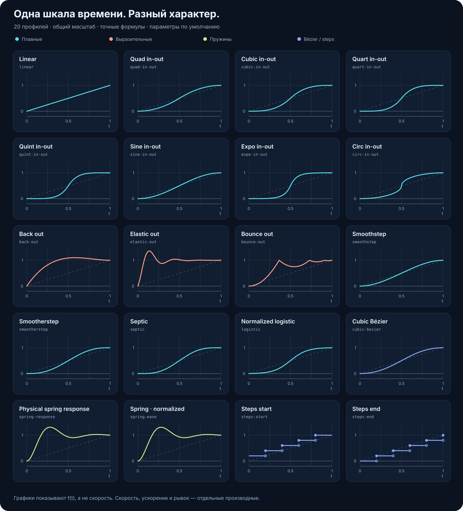
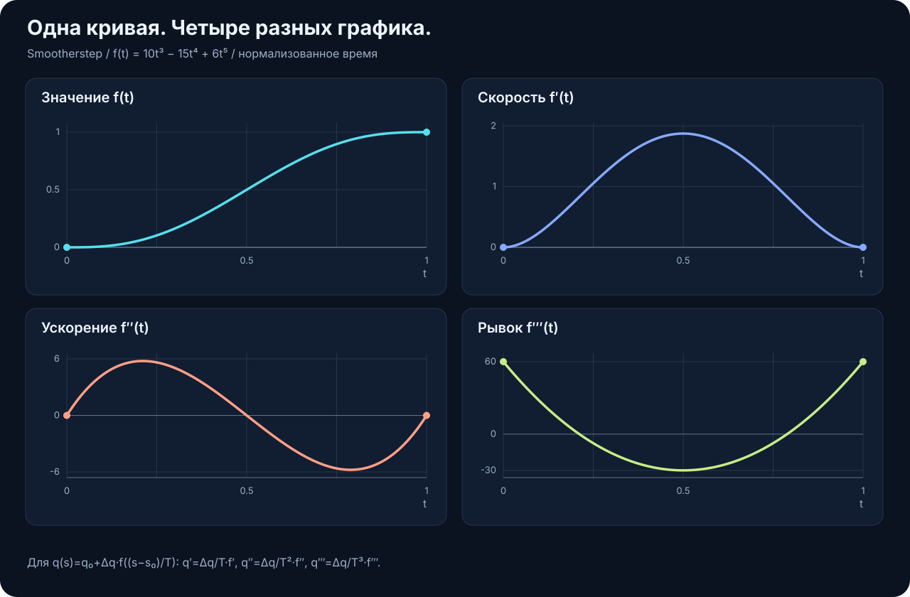

# Эссе I. Curve Atlas: как описывать изменение во времени

**Дата проверки источников:** 24 ноября 2026 года.

**Статус:** самостоятельный исследовательский обзор и математическая основа проекта.

**Назначение:** связать практику монтажа и анимации с интерполяцией, обработкой сигналов и планированием движения.

Это исследование подготовлено непосредственно для Curve System. Оно не выдается за результат ранее запущенного отдельного сеанса Deep Research: его итоговый отчет на момент подготовки этих материалов не был доступен. Формулы ниже, если не указано иное, сопровождаются собственным математическим разбором проекта. Практические рекомендации являются инженерными выводами, а не утверждениями об универсальном научно доказанном «лучшем движении».

## Содержание

1. [Что именно называется кривой](#1-что-именно-называется-кривой)
2. [Значение, скорость и время](#2-значение-скорость-и-время)
3. [Карта семейств](#3-карта-семейств)
4. [Почему одинаково плавные линии движутся по-разному](#4-почему-одинаково-плавные-линии-движутся-по-разному)
5. [Bézier, Hermite и сплайны](#5-bézier-hermite-и-сплайны)
6. [Пружина, отскок и физическое состояние](#6-пружина-отскок-и-физическое-состояние)
7. [Minimum jerk и minimum snap](#7-minimum-jerk-и-minimum-snap)
8. [Видеомонтаж, траектории и управление камерой](#8-видеомонтаж-траектории-и-управление-камерой)
9. [Аудио, окна и огибающие](#9-аудио-окна-и-огибающие)
10. [Процедурная графика и повторение](#10-процедурная-графика-и-повторение)
11. [Что известно о восприятии](#11-что-известно-о-восприятии)
12. [Как превратить знания в работающий атлас](#12-как-превратить-знания-в-работающий-атлас)
13. [Открытые исследовательские задачи](#13-открытые-исследовательские-задачи)
14. [Источники](#14-источники)

## 1. Что именно называется кривой

В монтажной практике одна и та же линия может означать совершенно разные вещи. В одном редакторе она показывает положение объекта, в другом — скорость воспроизведения, в третьем — непрозрачность, в четвертом — маршрут камеры. Визуальное сходство линий не делает эти объекты взаимозаменяемыми. Если агент копирует график без указания его смысла, он может получить математически корректную, но художественно противоположную анимацию.

Предлагаемая основа Curve System — **типизированная функция изменения**, а не коллекция названий эффектов. Для каждого объекта должны быть известны независимая переменная, выходная величина, единицы, область определения и поведение на границах.

| Вид объекта | Вход → выход | Что описывает | Характерный вопрос |
|---|---|---|---|
| Easing / timing function | прогресс → прогресс | темп перехода между состояниями | Как распределить движение внутри длительности? |
| Value curve | время → значение | готовую анимацию параметра | Какова непрозрачность в момент 1,2 секунды? |
| Velocity profile | время → производная значения | скорость изменения со знаком | Когда начинается торможение? |
| Spatial path | параметр → точка | геометрию маршрута | Где проходит камера? |
| Envelope | время → амплитуда | атаку, удержание, спад | Как появляется и затухает эффект? |
| Oscillator / noise | время → сигнал | периодическое или процедурное изменение | Как дрожит свет или движется вторичный элемент? |
| State-based motion | состояние + цель → новое состояние | реакцию системы на меняющуюся цель | Как продолжить движение после вмешательства? |

W3C определяет easing как отображение входного прогресса в выходной; выход не обязан оставаться между нулем и единицей. Это существенно для overshoot. У CSS есть также собственные правила вычисления вне основного интервала, поэтому простое ограничение аргумента диапазоном [0,1] не воспроизводит весь стандарт. См. [CSS Easing Functions Level 2](https://www.w3.org/TR/css-easing-2/).

Таксономия должна допускать разные представления одного поведения. Кривая может храниться аналитической формулой, контрольными точками, кусочными полиномами, измеренными отсчетами или физическими параметрами. Это способы описания, а не обязательные отдельные семейства движений.

## 2. Значение, скорость и время

Пусть переход длится $T>0$ секунд, начинается в $s_0$, а значение меняется от $q_0$ до $q_1$. Нормированное время и итоговая анимация:

$$
\tau=\frac{s-s_0}{T},\qquad
q(s)=q_0+(q_1-q_0)f(\tau).
$$

Здесь $f$ — только форма распределения прогресса. Физическое движение возникает после задания длительности, амплитуды и интерполируемой величины. Из правила дифференцирования сложной функции следуют:

$$
\dot q=\frac{\Delta q}{T}f'(\tau),\qquad
\ddot q=\frac{\Delta q}{T^2}f''(\tau),\qquad
\dddot q=\frac{\Delta q}{T^3}f'''(\tau).
$$

Одна и та же миниатюра easing может дать почти неподвижный элемент или резкий бросок. При уменьшении длительности вдвое скорость удваивается, ускорение увеличивается в четыре раза, а рывок — в восемь. Поэтому карточка без длительности и амплитуды полезна для классификации формы, но недостаточна для оценки готового эффекта.

**Value graph и speed graph не являются двумя стилями рисования одной линии.** Первый показывает значение; второй — скорость изменения. Adobe описывает оба режима Graph Editor отдельно. В выражениях After Effects пространственная velocity возвращает вектор, а spatial speed — неотрицательную скалярную величину. Это различие важно при движении назад и по кривой траектории: модуль скорости не содержит направления. См. [Graph Editor](https://helpx.adobe.com/after-effects/desktop/animate-in-after-effects/animation-basics/animation-basics.html) и [Expression language reference](https://helpx.adobe.com/after-effects/desktop/work-with-expressions/expression-language-reference/expression-language-reference.html).

Если график **значения** напоминает S, движение обычно начинается медленно, ускоряется и затем замедляется. Если такую же S нарисовать как график **скорости**, объект будет все время набирать скорость. Для сценария «разгон — равномерное движение — торможение» нужен профиль скорости с полкой; график положения получится после интегрирования этого профиля.

Нормированная скорость $v(\tau)$, предназначенная для перехода от 0 до 1, должна удовлетворять условию площади:

$$
f(\tau)=
\frac{\int_0^\tau v(u)\,du}{\int_0^1 v(u)\,du},
\qquad \int_0^1v(u)\,du\ne0.
$$

При $v\ge0$ функция прогресса монотонна. Если скорость меняет знак, возможен возврат назад; если интеграл близок к нулю, нормализация становится неустойчивой. Отдельная настройка «скорости» без контроля площади может изменить конечное положение.

## 3. Карта семейств

На миниатюрах горизонтальная ось показывает нормированное время, вертикальная — значение. Наклон линии связан со скоростью; это не график самой скорости.

Таблица описывает математические классы, а не обещает, что каждый из них уже реализован в текущем прототипе. Конкретный состав вычисляемого каталога задается файлами проекта.

| Семейство | Нормированная модель или представление | Что регулируется | Что проверить |
|---|---|---|---|
| Linear | $f(\tau)=\tau$ | длительность | мгновенное включение скорости при удержании до/после |
| Power | $f_{\rm in}=\tau^p$, $p>0$ | степень | при $p<1$ наклон у старта неограничен |
| Sine | $f=(1-\cos\pi\tau)/2$ | обычно направление easing | нулевые скорости не означают нулевые ускорения |
| Exponential | $f=\operatorname{expm1}(k\tau)/\operatorname{expm1}(k)$ | $k$; при $k=0$ предел $\tau$ | точная нормализация, устойчивость малых и больших $k$ |
| Circular | $f_{\rm in}=1-\sqrt{1-\tau^2}$ | направление | вертикальная касательная при $\tau=1$ |
| Back | $f_{\rm in}=(a+1)\tau^3-a\tau^2$ | сила предварительного движения $a$ | отрицательный прогресс, область допустимых значений |
| Elastic | затухающая синусоида вокруг цели | частота, затухание, фаза | соглашения о краях, выход за диапазон |
| Bounce | кусочные дуги, часто параболические | число и высота отскоков | разрывы производной в моментах столкновения |
| Cubic Bézier | $f(\tau)=Y(X^{-1}(\tau))$ | две контрольные точки | решение по координате времени, вырожденные касательные |
| Cubic Hermite | значения и наклоны двух концов | начальная и конечная скорость | единицы наклонов и длительности сегментов |
| Smoothstep | $3\tau^2-2\tau^3$ | ширина перехода | $C^1$ при продолжении константами |
| Smootherstep | $10\tau^3-15\tau^4+6\tau^5$ | ширина перехода | $C^2$ при продолжении константами |
| Septic smoothstep | $35\tau^4-84\tau^5+70\tau^6-20\tau^7$ | ширина перехода | $C^3$ при продолжении константами |
| Normalized sigmoid | нормированная logistic или tanh | крутизна, положение перехода | обычная нормализация не зануляет крайние скорости |
| Beta CDF | $f=I_\tau(a,b)$, $a,b>0$ | асимметрия, концентрация | характер производных у краев зависит от $a,b$ |
| PCHIP / monotone Hermite | локальные кубические сегменты | узлы, shape-preserving наклоны | непрерывность ускорения не гарантирована |
| Cubic spline | кусочные кубики с согласованными производными | узлы, граничные условия | возможный overshoot между узлами |
| Jerk-limited S-curve | интегрирование ограниченного кусочного jerk | пределы $v,a,j$, начальное состояние | допустимость и синхронизация осей |
| Steps / hold | дискретные скачки или удержания | число ступеней, сторона скачка | значение точно на границе, отсутствие обычной производной |
| Envelope / window | rise–hold–fall, Hann, Gaussian и др. | атака, удержание, отпускание | другие граничные условия: часто 0 → 0 |
| Periodic / procedural | LFO, Fourier, noise | частоты, амплитуды, seed | повторяемость, спектр, aliasing |

Классические Penner-подобные семейства и параметры back/elastic представлены в [официальной документации d3-ease](https://d3js.org/d3-ease). Полезный принцип каталога: хранить преобразования in/out/in-out отдельно от базовой формулы, но не предполагать, что все библиотеки одинаково именуют вариант по умолчанию.

Для базовой функции $g$ с $g(0)=0,\ g(1)=1$:

$$
f_{\rm out}(\tau)=1-g(1-\tau),
$$

$$
f_{\rm inout}(\tau)=
\begin{cases}
\frac12g(2\tau), & \tau<\frac12,\\
1-\frac12g(2-2\tau), & \tau\ge\frac12.
\end{cases}
$$

Это преобразования формы, а не гарантия необходимой гладкости на центральном шве. Например, у степенного in-out при $p>1$ скорость в середине согласована, но ускорение меняет знак скачком. Нельзя заменять анализ производных надписью «ease-in-out».

## 4. Почему одинаково плавные линии движутся по-разному

Иллюстрация показывает производные по нормированному времени. Для физических единиц нужны множители $\Delta q/T^r$ из раздела 2.

Внутри открытого интервала полином имеет производные любого порядка. Но реальный клип обычно до начала неподвижен и после окончания удерживает последнее значение. Важна гладкость **составного движения**, включающего эти два участка.

Продолжим $f$ нулем слева и единицей справа. Если $f'(0)\ne0$, скорость в момент старта скачет. Если первые производные равны нулю, а вторые нет, скорость уже непрерывна, но ускорение включается скачком. На графике значения оба случая могут выглядеть вполне аккуратно.

| Переход между удержаниями | Непрерывность | Непрерывные физические величины |
|---|---|---|
| Linear | $C^0$ | значение |
| Cubic smoothstep | $C^1$ | значение, скорость |
| Quintic smootherstep | $C^2$ | значение, скорость, ускорение |
| Septic smoothstep | $C^3$ | значение, скорость, ускорение, рывок |

Здесь класс $C^k$ относится именно к продолжению за границы. Для smoothstep определение с ограничением аргумента и кубической формулой подтверждается [спецификацией GLSL](https://github.khronos.org/Vulkan-Site/glsl/latest/chapters/builtinfunctions.html). Остальные характеристики таблицы получаются прямым дифференцированием.

Общую конструкцию дает интеграл:

$$
S_m(\tau)=
\frac{\int_0^\tau u^m(1-u)^m\,du}
{\int_0^1 u^m(1-u)^m\,du},\qquad m=0,1,2,\ldots
$$

Его производная имеет нули порядка $m$ на обоих краях. При продолжении константами получаем $C^m$. Для $m=1,2,3$ это кубический, квинтический и септический smoothstep. Асимметричная beta-модель позволяет распределить разгон и торможение несимметрично, не переходя сразу к ручному редактированию множества контрольных точек.

Высокий порядок гладкости не делает движение автоматически удачным. При фиксированной длительности дополнительные требования к краям перераспределяют скорость внутри интервала. В результате движение может дольше «собираться», а затем сильнее ускоряться. Поэтому атласу нужны и графики производных, и живая демонстрация при одинаковых расстоянии и времени.

## 5. Bézier, Hermite и сплайны

У кубического Bézier есть собственный параметр $u$. Контрольные точки задают две функции $X(u)$ и $Y(u)$. В timing function время соответствует $X$, поэтому сначала необходимо решить $X(u)=\tau$, затем вернуть $Y(u)$. Подстановка $Y(\tau)$ в общем случае неверна. Ограничение CSS на x-координаты контрольных точек обеспечивает допустимую временную форму; y-координаты допускают overshoot. См. [определение cubic-bezier](https://www.w3.org/TR/css-easing-2/#cubic-bezier-easing-functions).

Для реализации удобна комбинация быстрого метода Ньютона и устойчивого поиска в интервале. Если $X'$ близка к нулю, шаг Ньютона может оказаться ненадежным; бисекция сохраняет границы решения. Критерий остановки должен учитывать и ошибку времени, и требуемую точность выходного значения. Это инженерный вывод из устройства обратной задачи.

Важная производная:

$$
\frac{df}{d\tau}=\frac{Y'(u)}{X'(u)}.
$$

Наклон на плоском рисунке действительно связан со скоростью. Но там, где $X'=0$, обычная запись отношения перестает быть достаточной: нужно исследовать предел. Иногда получится бесконечный наклон, иногда — конечная устранимая особенность. Нельзя во всех таких случаях возвращать ноль или обрезать график без пояснения.

Hermite полезен, когда пользователь мыслит не ручками на плоскости, а состояниями: «войти с такой скоростью, закончить с другой». Для сегмента длительности $T$ физические скорости входят в полином с коэффициентом $T$. При изменении длины сегмента оставленные без пересчета нормированные наклоны меняют физическую скорость.

Для набора ключей выбор сплайна является содержательным решением. [SciPy CubicSpline](https://docs.scipy.org/doc/scipy/reference/generated/scipy.interpolate.CubicSpline.html) строит $C^2$-интерполянт с явными граничными условиями. [PCHIP](https://docs.scipy.org/doc/scipy/reference/generated/scipy.interpolate.PchipInterpolator.html) сохраняет монотонность данных, но гарантирует лишь $C^1$: вторые производные на узлах могут расходиться. Для прозрачности и накопленного прогресса сохранение формы часто важнее гладкого ускорения; для камеры может оказаться наоборот.

Практический вывод: в Curve System нужны независимые признаки «монотонная», «без выхода за диапазон», «непрерывная скорость», «непрерывное ускорение». Единственный рейтинг «плавность 9/10» скрывает именно те различия, ради которых нужен каталог.

## 6. Пружина, отскок и физическое состояние

Пружинное движение определяется дифференциальным уравнением:

$$
m\ddot x+c\dot x+k(x-x_\ast)=0.
$$

У него есть масса $m$, жесткость $k$, демпфирование $c$, положение $x$, скорость $\dot x$ и цель $x_\ast$. В отличие от easing с фиксированным концом, система имеет состояние и может реагировать на новую цель в середине движения.

Обозначим $\omega_n=\sqrt{k/m}$ и $\zeta=c/(2\sqrt{km})$. При $0<\zeta<1$ возникают затухающие колебания, при $\zeta=1$ — критическое демпфирование, при $\zeta>1$ — апериодический режим. Эти утверждения и формулы здесь выводятся из характеристического уравнения линейной системы; они не означают, что любой параметр с названием spring в библиотеке использует именно такую модель.

Для старта из покоя в нуле и постоянной цели 1 при $0<\zeta<1$:

$$
x(s)=1-e^{-\zeta\omega_n s}
\left[
\cos(\omega_ds)+
\frac{\zeta}{\sqrt{1-\zeta^2}}\sin(\omega_ds)
\right],
\qquad
\omega_d=\omega_n\sqrt{1-\zeta^2}.
$$

Такая пружина в общем случае не попадает точно в цель с нулевой скоростью в заранее выбранную секунду. Если обрезать ее на $T$ и перенормировать в диапазон 0 → 1, получится полезный конечный easing, но изменятся амплитуда и физическая интерпретация. После принудительного удержания могут возникнуть скачки производных.

Поэтому каталог должен различать **physical spring**, **duration-normalized spring response** и **elastic easing**. Первое подходит для прерываемого взаимодействия, второе — для синхронного монтажа по таймлайну, третье — для управляемой стилизации.

Bounce также не следует автоматически понимать как симуляцию. Кусочные параболы могут выразительно передавать удар и отскок, но скорость на стыке меняется скачком. Для стилизованной карточки это свойство, для механического привода — нарушение ограничения ускорения. Параметр коэффициента восстановления имеет физический смысл только в модели, где явно заданы столкновения, скорости до/после и потери энергии.

При смене цели полезнее сохранять текущее состояние, чем снова начинать easing с нулевой скорости. В одномерном случае согласование положения и скорости устраняет разрыв $C^1$; согласование ускорения нужно для $C^2$. Конкретный выбор зависит от того, разрешены ли overshoot, задержка и изменение длительности.

## 7. Minimum jerk и minimum snap

В работе Flash и Hogan исследовались произвольные движения руки человека в горизонтальной плоскости. Модель минимизировала интеграл квадрата рывка и объясняла ряд наблюдаемых пространственно-временных характеристик. Это конкретная экспериментальная модель двигательной координации, а не доказательство оптимальности одного easing для всех экранных переходов. Первоисточник: [Flash & Hogan, 1985, DOI 10.1523/JNEUROSCI.05-07-01688.1985](https://doi.org/10.1523/JNEUROSCI.05-07-01688.1985).

Для одного скалярного перехода, фиксированной длительности и условий

$$
q(0)=0,\ q(T)=1,\quad
\dot q(0)=\dot q(T)=0,\quad
\ddot q(0)=\ddot q(T)=0
$$

минимизация

$$
J=\int_0^T\left(\dddot q(s)\right)^2ds
$$

дает квинтический полином. В нормированном времени это $10\tau^3-15\tau^4+6\tau^5$, совпадающий с smootherstep. Уравнение Эйлера для этой задачи имеет вид $q^{(6)}=0$; шесть граничных условий определяют шесть коэффициентов. Совпадение формул не делает любую квинтическую кривую «minimum jerk»: измененные граничные условия, препятствия и свободное время меняют задачу.

Если минимизировать квадрат четвертой производной при фиксированных положении, скорости, ускорении и рывке на обоих концах, получается полином степени семь. Для нулевых крайних производных это septic smoothstep из таблицы. Но робототехническая задача minimum snap может включать множество промежуточных точек, ограничения коридоров и оптимизацию коэффициентов соседних сегментов. Ее нельзя заменить одним пресетом степени семь.

Именно такой прикладной контекст демонстрирует [Mellinger & Kumar, 2011, DOI 10.1109/ICRA.2011.5980409](https://doi.org/10.1109/ICRA.2011.5980409): планирование и управление полетом квадрокоптера. Исследование полезно для архитектуры составных траекторий, однако не переносит автоматически требования летательного аппарата на титры или появление кнопки.

Другая постановка — получить **минимальное время** при ограничениях скорости, ускорения и рывка. Это не минимизация интеграла jerk. [Berscheid & Kröger, RSS 2021](https://www.roboticsproceedings.org/rss17/p015.html), DOI [10.15607/RSS.2021.XVII.015](https://doi.org/10.15607/RSS.2021.XVII.015), описывают Ruckig для переходов между кинематическими состояниями с такими ограничениями.

Для фиксированной формы $f$ можно независимо оценить допустимую длительность. Если $M_r=\max_{\tau\in[0,1]}|f^{(r)}(\tau)|$, то для прямолинейного скалярного перехода с симметричными пределами достаточно проверить:

$$
T\ge
\max\left(
\frac{|\Delta q|M_1}{v_{\max}},
\sqrt{\frac{|\Delta q|M_2}{a_{\max}}},
\sqrt[3]{\frac{|\Delta q|M_3}{j_{\max}}}
\right).
$$

Это собственный вывод из масштабирования производных. Он применим при конечных соответствующих производных и корректных стыках. Он не решает общую многомерную динамику и не гарантирует глобально минимального времени среди всех возможных форм.

## 8. Видеомонтаж, траектории и управление камерой

Для видеоредактора существуют два особенно важных вида кривых: анимация параметра эффекта и преобразование времени исходного клипа. В первом случае значение может означать радиус размытия, фокус, масштаб, экспозицию или координату. Во втором выходом является время исходника.

Если $u(s)$ — исходное время в секундах как функция времени монтажа, то $du/ds$ — коэффициент скорости воспроизведения. Нулевая производная создает стоп-кадр, отрицательная — обратное воспроизведение. При нормировании двух клипов с разной длительностью масштаб исходного времени необходимо учитывать явно.

Скоростной ramp часто рисуют как профиль скорости. При переносе такого графика в редактор с value-based time remap его надо интегрировать. Кроме того, итоговая площадь определяет, сколько исходного материала будет пройдено. Если скорость поднять в середине, сохранив длину монтажа и все остальные участки, конечный исходный кадр изменится. Следовательно, интерфейс должен показывать одновременно скорость и накопленное исходное время.

Для пространственного движения зададим маршрут $\mathbf r(u)$ и временной закон $u=f(\tau)$. Скорость:

$$
\frac{d\mathbf r}{ds}
=\frac1T\mathbf r'(u)f'(\tau).
$$

Равномерный параметр не гарантирует равномерной длины пути. У Bézier геометрическая скорость $\|\mathbf r'(u)\|$ обычно меняется вдоль кривой. Для движения по расстоянию строят длину дуги $\ell(u)=\int_0^u\|\mathbf r'(z)\|dz$, обращают ее и используют $u=\ell^{-1}(Lf(\tau))$, где $L$ — полная длина. При монотонном $f$ внутри диапазона скорость становится $Lf'(\tau)/T$.

Но ускорение камеры включает и изменение направления. Для произвольного параметра:

$$
\frac{d^2\mathbf r}{ds^2}
=\frac1{T^2}
\left[\mathbf r''(u)(f')^2+\mathbf r'(u)f''\right].
$$

Даже идеально ровный график скалярной скорости не устраняет центростремительное ускорение на поворотах. Это объясняет, почему выбор одной «очень плавной» временной кривой не исправляет резкие углы маршрута.

В робототехнике геометрия и допустимое время рассматриваются совместно с ограничениями движения. [Pham & Pham, 2018, DOI 10.1109/TRO.2018.2819195](https://doi.org/10.1109/TRO.2018.2819195), с [доступным препринтом](https://arxiv.org/abs/1707.07239), предлагают расчет временной параметризации через достижимые множества. Для Curve System это источник идей о слоях архитектуры: path, timing, constraints и evaluation следует хранить раздельно.

## 9. Аудио, окна и огибающие

Кривая громкости в интерфейсе может управлять линейным коэффициентом усиления, децибелами или иной шкалой. Эти варианты дают разные сигналы. При амплитудной записи $A_{\rm dB}=20\log_{10}g$ линейная интерполяция децибел соответствует геометрической интерполяции положительного gain. Ноль не имеет конечного значения в децибелах.

[Web Audio API](https://www.w3.org/TR/webaudio/#dom-audioparam-exponentialramptovalueattime) задает экспоненциальную автоматизацию через отношение начального и конечного значений. Экспоненциальный ramp к точному нулю не определен этим методом. Поэтому проекту нужны метаданные о пространстве интерполяции, допустимом диапазоне и политике завершения затухания.

Особенно нагляден crossfade двух сигналов:

$$
y=g_1x_1+g_2x_2.
$$

Для равномощных некоррелированных сигналов постоянную ожидаемую мощность дает $g_1^2+g_2^2=1$. Один вариант — $g_1=\cos(\pi\tau/2)$, $g_2=\sin(\pi\tau/2)$. Для двух одинаковых синфазных сигналов важна уже сумма $g_1+g_2$; равномощный crossfade усилит середину. Для сигналов с нулевым средним это прямой вывод из

$$
P_y=g_1^2P_1+g_2^2P_2+2g_1g_2\,\mathrm{Cov}(x_1,x_2).
$$

Следовательно, название «плавный crossfade» не определяет корректный закон смешивания. Нужно знать корреляцию материалов, их уровни и цель перехода. Видеокроссфейд также зависит от пространства цвета и способа композиции; готовая аудиокривая не является универсальным рецептом визуальной яркости.

Оконная функция — еще один тип объекта. У Hann нормированная форма $w(\tau)=\tfrac12-\tfrac12\cos(2\pi\tau)$ начинается и заканчивается в нуле. Она не соответствует обычному переходу 0 → 1. Окна используют для управления краями ограниченного сигнала и его спектром; [Julius O. Smith, Spectral Audio Signal Processing](https://dsprelated.com/freebooks/SASP/Hann_Hanning_Raised_Cosine.html) связывает форму Hann с поведением спектральных боковых лепестков. [SciPy](https://docs.scipy.org/doc/scipy/reference/generated/scipy.signal.windows.hann.html) отдельно различает симметрический и периодический варианты дискретного окна.

Для монтажа из этого получается самостоятельный раздел атласа: attack/release, ADSR, crossfade pairs и windows. Их не стоит помещать в единый список easing без указания типа выхода и граничных условий.

## 10. Процедурная графика и повторение

Квинтический smoothstep встречается не только в движении. В [Improved Noise Кена Перлина](https://mrl.cs.nyu.edu/~perlin/noise/) используется та же функция $6t^5-15t^4+10t^3$. В [авторском объяснении в GPU Gems](https://developer.nvidia.cn/gpugems/gpugems/part-i-natural-effects/chapter-5-implementing-improved-perlin-noise) ее выбор связан с устранением разрывов вторых производных. Это сильный пример межотраслевого переноса: одинаковая математика решает проблему стыков и в пространственном шуме, и во временной анимации.

Но шум нельзя приравнивать к transition. Для процедурного эффекта необходимо знать seed, частоты, амплитуды, число октав и временную дискретизацию. Если одни и те же настройки каждый раз дают разные отсчеты, агент не сможет воспроизводимо сравнить варианты или получить идентичный экспорт и preview.

Для периодического движения нужно согласовать не только значение на концах, но и производные. Простой повтор кривой 0 → 1 создает скачок при сбросе. Исключение возникает, если сама анимируемая величина периодична: например, угол 0 и $2\pi$ может задавать одинаковую ориентацию. Даже тогда линейная интерполяция чисел и интерполяция ориентаций не всегда одно и то же.

Ping-pong тоже требует анализа. Отражение направления в конце отрезка создает скачок скорости, если скорость там не равна нулю. Нулевой крайний наклон улучшает стык, но непрерывность ускорения и более высоких производных проверяются отдельно.

Резкие ступени и высокочастотная дрожь иногда нужны художественно. Их не надо объявлять ошибкой из-за низкого класса гладкости. Важнее честно показать ограничения: конечная частота кадров может не передать быстрые колебания, а спектральное содержание влияет на результат дискретизации. Для таких кривых полезны режим покадрового просмотра и отметка частоты воспроизведения.

## 11. Что известно о восприятии

Классическая анимация рассматривает slow-in/slow-out вместе с anticipation, staging, exaggeration и другими приемами. [Lasseter, 1987](https://users.cs.northwestern.edu/~animation/Lasseter_1987.pdf), DOI [10.1145/37402.37407](https://doi.org/10.1145/37402.37407), переносит эти принципы в трехмерную компьютерную анимацию. Это важный язык художественного решения, но не таблица численных параметров, одинаково подходящих каждому интерфейсу.

Экспериментальное исследование [Heer & Robertson, 2007](https://sites.stat.columbia.edu/gelman/communication/HeerRobertson2007.pdf), DOI [10.1109/TVCG.2007.70539](https://doi.org/10.1109/TVCG.2007.70539), показывает пользу определенным образом организованных переходов между статистическими графиками. Из него разумно взять идею сохранения понимания соответствий между состояниями. Из него нельзя вывести, что bounce, spring или minimum jerk всегда повышают удобство любой программы.

Следовательно, атласу нужны разные уровни доказательности:

- **Математическое свойство:** монотонность, предел, производная, точная ошибка аппроксимации.
- **Поведение конкретной реализации:** результат теста при определенных параметрах и версии библиотеки.
- **Наблюдение в исследовании:** выборка, задача, метрика и условия эксперимента.
- **Дизайнерская рекомендация:** мотивированный выбор, который нужно проверить в контексте продукта.

Эти категории нельзя смешивать в одной подписи «научно оптимально». Особенно осторожно следует переносить результаты биомеханики на экран: физическое движение руки, визуальное перемещение карточки и скорость изменения непрозрачности имеют разные задачи.

Доступность также является частью выбора. [WCAG 2.2, критерий 2.3.3 уровня AAA](https://www.w3.org/WAI/WCAG22/Understanding/animation-from-interactions) рассматривает возможность отключения несущественной анимации, вызванной взаимодействием. Для интерактивного атласа отсюда следует практическое решение: статические графики доступны всегда, движение запускается явно, а пользовательские предпочтения reduced motion учитываются. Другая функция easing сама по себе не заменяет возможности отключить движение.

## 12. Как превратить знания в работающий атлас

Главная ценность каталога — возможность быстро ответить на вопрос: **«Какой закон изменения подходит моему намерению и ограничениям?»** Для этого недостаточно максимального количества миниатюр.

Каждая карточка должна показывать функцию значения, производные доступного порядка и движение на общей шкале длительности. Нужны видимые нули и диапазоны осей: автоматическое растяжение каждой кривой по высоте может скрыть разницу пиковых скоростей. Для overshoot следует сохранять выход за [0,1], иначе визуализация исказит главное свойство семейства.

Непрерывные графики и дискретные события требуют разных обозначений. На скачке нужны незакрашенная и закрашенная точки либо явная подпись стороны. На разрыве скорости нельзя соединять производную сглаживающей линией. Если численная производная оценена конечными разностями, ее нужно отличать от аналитической.

Полезен двухэтапный выбор. Сначала система отбрасывает несовместимые кривые: например, возврат времени недопустим для последовательного прохождения клипа, отрицательный масштаб запрещен конкретным эффектом, скорость должна сохраняться после изменения цели. Затем человек сравнивает выразительность оставшихся вариантов.

Для агента это превращается в последовательность:

1. Определить, что интерполируется, в каких единицах и в каком пространстве.
2. Уточнить состояние на входе и требуемое состояние на выходе.
3. Установить ограничения диапазона, монотонности и производных.
4. Выбрать семейство и параметры, не подменяя эти ограничения словами «мягко» или «органично».
5. Проверить математические свойства и увидеть движение при целевой длительности.
6. Экспортировать в нужную среду с указанием соглашений, потерь точности и поведения вне интервала.

Пример запроса «камера должна мягко догнать объект» указывает прежде всего на меняющуюся цель и сохранение состояния. Запрос «радиус эффекта растет от 0 до 40 за 18 кадров и точно останавливается» указывает на конечный переход с фиксированным временем. Внешне оба запроса могут звучать как «сделай плавно», но требовать разных вычислительных моделей.

## 13. Открытые исследовательские задачи

Первое направление — **аппроксимация с доказуемой ошибкой**. Не всякая пружина или многосегментная функция точно выражается одним cubic-bezier. Экспорт должен различать точное представление и приближение, измерять максимальную ошибку значения и, когда нужно, ошибку производных. Низкая ошибка значения не гарантирует близкую скорость.

Второе — **составление переходов без потери состояния**. Нужны правила согласования физических скоростей и ускорений между сегментами разной длительности. Это особенно полезно для интерактивного редактора, где пользователь двигает ключ, пока анимация идет.

Третье — **сравнение художественных намерений**. Такие слова, как «тяжелый», «упругий», «спокойный», полезны для поиска, но не имеют единственной формулы. Их следует связывать с наборами кандидатов и примерами, затем уточнять по реакции пользователя. Недопустимо выдавать субъективную метку за математическую гарантию.

Четвертое — **общая временная система для видео, аудио и графики**. Здесь сложность заключается в единицах, частотах дискретизации, пространствах интерполяции и ограничениях экспорта. Общий реестр функций возможен; единый одинаковый способ применения ко всем типам данных — нет.

Пятое — **воспроизводимые исследования восприятия**. Каталог может стать экспериментальным стендом: фиксированные расстояния, длительности, частоты кадров и задачи; случайный порядок вариантов; измерение ошибок и предпочтений. Такие результаты позволят постепенно заменить общие эпитеты проверяемыми рекомендациями для конкретных сценариев.

## 14. Источники

Источники сгруппированы по назначению. Прямые ссылки ведут к стандартам, официальной документации, авторским публикациям или научным статьям; перечень не означает, что каждая методика реализована в проекте.

| Источник | Для чего нужен |
|---|---|
| [W3C CSS Easing Functions Level 2](https://www.w3.org/TR/css-easing-2/) | Семантика timing functions, Bézier, steps, поведение вне интервала |
| [Adobe: Animation basics / Graph Editor](https://helpx.adobe.com/after-effects/desktop/animate-in-after-effects/animation-basics/animation-basics.html) | Различие value graph и speed graph |
| [Adobe: Speed](https://helpx.adobe.com/after-effects/desktop/animate-in-after-effects/speed-between-keyframes/speed.html) | Длительность, амплитуда и influence ключей |
| [Adobe: Expression language reference](https://helpx.adobe.com/after-effects/desktop/work-with-expressions/expression-language-reference/expression-language-reference.html) | Velocity, spatial speed, time remap, единицы свойств |
| [D3: d3-ease](https://d3js.org/d3-ease) | Классические семейства и параметры easing |
| [Khronos: GLSL built-in functions](https://github.khronos.org/Vulkan-Site/glsl/latest/chapters/builtinfunctions.html) | Определение smoothstep |
| [SciPy: PchipInterpolator](https://docs.scipy.org/doc/scipy/reference/generated/scipy.interpolate.PchipInterpolator.html) | Shape preservation, монотонность, $C^1$ |
| [SciPy: CubicSpline](https://docs.scipy.org/doc/scipy/reference/generated/scipy.interpolate.CubicSpline.html) | $C^2$-сплайны и граничные условия |
| [Flash & Hogan, 1985](https://doi.org/10.1523/JNEUROSCI.05-07-01688.1985) | Экспериментальная модель minimum jerk |
| [Mellinger & Kumar, 2011](https://doi.org/10.1109/ICRA.2011.5980409) | Minimum snap в управлении квадрокоптерами |
| [Berscheid & Kröger, 2021](https://www.roboticsproceedings.org/rss17/p015.html) | Ограниченный jerk и оптимальное время |
| [Pham & Pham, 2018](https://doi.org/10.1109/TRO.2018.2819195) / [препринт](https://arxiv.org/abs/1707.07239) | Временная параметризация заданного пути |
| [W3C Web Audio API](https://www.w3.org/TR/webaudio/) | Автоматизация параметров и экспоненциальные ramps |
| [Julius O. Smith: Hann window](https://dsprelated.com/freebooks/SASP/Hann_Hanning_Raised_Cosine.html) | Связь окон, краев и спектрального поведения |
| [SciPy: Hann](https://docs.scipy.org/doc/scipy/reference/generated/scipy.signal.windows.hann.html) | Симметрические и периодические дискретные окна |
| [Ken Perlin: Improved Noise](https://mrl.cs.nyu.edu/~perlin/noise/) | Квинтическая функция в процедурной графике |
| [Ken Perlin: GPU Gems, глава 5](https://developer.nvidia.cn/gpugems/gpugems/part-i-natural-effects/chapter-5-implementing-improved-perlin-noise) | Причина изменения порядка гладкости noise |
| [Lasseter, 1987](https://doi.org/10.1145/37402.37407) / [полный текст](https://users.cs.northwestern.edu/~animation/Lasseter_1987.pdf) | Художественные принципы анимации |
| [Heer & Robertson, 2007](https://doi.org/10.1109/TVCG.2007.70539) / [полный текст](https://sites.stat.columbia.edu/gelman/communication/HeerRobertson2007.pdf) | Экспериментальная оценка переходов в визуализации данных |
| [W3C: Understanding SC 2.3.3](https://www.w3.org/WAI/WCAG22/Understanding/animation-from-interactions) | Отключение несущественной анимации |

**Дальше:** [математический справочник](../docs/mathematics.md) и [инженерное эссе](02-engine-and-agent.md).
